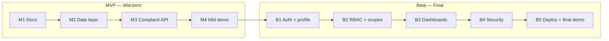

# Product Requirements Document (PRD) — Campus Complaint Management System

| Field | Value |
|---|---|
| Product | Campus Complaint Management System (CCMS) |
| Version | MVP + Beta |
| Releases | MVP — Mid-term, Beta — Final |
| Status | Draft |
| Related docs | [Software Requirements Specification (SRS)](02-srs.md), [Technical Design Document (TDD)](03-tdd.md) |

This document covers **both releases**. Every goal, feature and story has a **Release** column so it is clear what is shown at the mid-term demo and what is added for the final demo.

**Documents in this set**

| Short form | Full form | Purpose | File |
|---|---|---|---|
| PRD | Product Requirements Document | What we build and why (this document) | [01-prd.md](01-prd.md) |
| SRS | Software Requirements Specification | Exact requirements, permissions and acceptance criteria | [02-srs.md](02-srs.md) |
| TDD | Technical Design Document | How we build it: architecture, data model, API | [03-tdd.md](03-tdd.md) |

## 0. Release plan

| Release | When | Focus |
|---|---|---|
| **MVP** | Mid-term | Core features through REST APIs (complaint CRUD + status update), running locally |
| **Beta** | Final | Authentication, user roles (RBAC), user profile dashboard, security scopes/permissions, deployment |

## 1. Purpose

Students at a campus report problems (hostel, library, cafeteria, IT, academics) through verbal requests, notice boards or scattered messages. Complaints get lost, students cannot see what happened to them, and the administration has no single place to review them.

The Campus Complaint Management System is built in two clear steps:

1. **MVP (mid-term):** a small, working **REST API to submit, view, edit, delete and resolve complaints (CRUD + status update)**, running locally.
2. **Beta (final):** turn the MVP into a secure multi-user product: accounts and login, roles (RBAC), security scopes, a profile dashboard, an admin dashboard, and deployment.

## 2. Problem statement

Students need one reliable place to submit a complaint and follow its progress. Administrators need one place to see all complaints, respond to them and mark them resolved. A student's complaints must stay private from other students, and only administrators may decide the outcome of a complaint.

## 3. Goals

| ID | Goal | Release |
|---|---|---|
| G-1 | Provide a REST API for complaint CRUD that follows standard REST conventions. | MVP |
| G-2 | Move each complaint through a clear status flow (`pending` → `in_progress` → `resolved` / `rejected`) with an admin response. | MVP |
| G-3 | Store complaints in a database so data survives restarts. | MVP |
| G-4 | Document the API automatically (OpenAPI at `/api/docs`). | MVP |
| G-5 | Each student has an account and sees only their own complaints. | Beta |
| G-6 | Control access with roles: `student` and `admin`. | Beta |
| G-7 | Enforce fine-grained permissions with security scopes on every endpoint. | Beta |
| G-8 | Give each user a profile dashboard and give admins a dashboard with system stats. | Beta |
| G-9 | Protect accounts and data (hashed passwords, token security, secrets in env vars). | Beta |
| G-10 | Deploy the system to a public URL. | Beta |

## 4. Target users

| User | Need | Release |
|---|---|---|
| Student / complainant | Submit, view, edit and delete complaints and see the admin's response. | MVP |
| Admin (campus staff) | See complaints, change their status and write a response. | MVP |
| Frontend developer | A clear, documented API to build the UI on. | MVP |
| Instructor / reviewer | An easy way to try the API (`/api/docs`) and check the code. | MVP |
| Registered student | Private complaint list behind a login, and a profile dashboard with name, password and complaint counts. | Beta |
| Admin (with account) | See all complaints, manage users and roles, and see usage stats on a dashboard. | Beta |

In the **MVP** there are no accounts: all complaint endpoints are open and there is one shared list. In the **Beta** every complaint belongs to a student.

## 5. Scope

### In scope — MVP (mid-term)
- Submit, list (with pagination and filters), view, edit (while pending), delete (while pending) complaints
- Update a complaint's status and admin response
- Input validation and clear error responses
- Health check endpoint
- Interactive API docs at `/api/docs`
- Runs locally with SQLite

### In scope — Beta (final)
- **Auth:** sign up, log in, log out, refresh session (JWT access token + refresh token)
- **User profile:** see my profile, change my name, change my password
- **Own complaints:** every complaint belongs to a student; students only see their own
- **RBAC:** `student` and `admin` roles; admin sees all complaints, changes status, manages roles
- **Security scopes/permissions:** the access token carries scopes and each endpoint requires a scope
- **Dashboards:** profile dashboard (my complaints by status) and admin dashboard (stats)
- **Security:** hashed passwords, secure cookies, security headers, secrets only in env vars
- **Deployment** to a public URL (Vercel + Supabase PostgreSQL)

### Out of scope for this semester
- Automated test suite and CI/CD pipeline
- File or image attachments on complaints
- Email/SMS notifications
- Anonymous complaints
- Routing complaints to several departments, assigning complaints to staff
- Comments or chat threads on a complaint
- Email verification, password reset, social login, changing email
- Banning users, login attempt limits

## 6. Features and priority (MoSCoW)

Priorities are per release: a Beta "Must" is required for the final, not for the mid-term.

| ID | Feature | Release | Priority |
|---|---|---|---|
| F-1 | Submit complaint | MVP | Must |
| F-2 | List complaints | MVP | Must |
| F-3 | Get complaint by ID | MVP | Must |
| F-4 | Edit complaint (only while `pending`) | MVP | Must |
| F-5 | Delete complaint (only while `pending`) | MVP | Must |
| F-6 | Update status and admin response | MVP | Must |
| F-7 | Validation and error responses | MVP | Must |
| F-8 | Health check | MVP | Must |
| F-9 | Pagination and filter by status / category | MVP | Should |
| F-10 | Simple page that uses the API | MVP | Could |
| F-11 | Sign up, log in, log out, refresh session | Beta | Must |
| F-12 | Complaints owned by a student, private | Beta | Must |
| F-13 | Roles `student` / `admin` with permission checks | Beta | Must |
| F-14 | Security scopes in the access token, enforced per endpoint | Beta | Must |
| F-15 | User profile: view profile, change name, change password | Beta | Should |
| F-16 | Profile dashboard (my complaints by status) | Beta | Should |
| F-17 | Admin: list users, change role | Beta | Should |
| F-18 | Admin dashboard stats | Beta | Should |
| F-19 | Security hardening (hashing, cookies, headers) | Beta | Must |
| F-20 | Deployment to a public URL | Beta | Must |
| F-21 | Pages for login, my complaints and dashboards | Beta | Could |

## 7. User stories

### MVP

| ID | Story | Feature |
|---|---|---|
| US-01 | As a student, I want to submit a complaint with a title, description and category, so the campus knows about my problem. | F-1 |
| US-02 | As a user, I want to see a list of complaints, so I can find one quickly. | F-2, F-9 |
| US-03 | As an admin, I want to filter complaints by status and category, so I can focus on what needs attention. | F-9 |
| US-04 | As a student, I want to open one complaint, so I can read its status and the admin response. | F-3 |
| US-05 | As a student, I want to edit a complaint that is still pending, so I can fix mistakes. | F-4 |
| US-06 | As a student, I want to delete a complaint that is still pending, so I can withdraw it. | F-5 |
| US-07 | As an admin, I want to change a complaint's status and write a response, so the student knows what happened. | F-6 |
| US-08 | As a client developer, I want clear error messages, so I know what went wrong. | F-7 |
| US-09 | As a maintainer, I want a health endpoint, so I can check the system is running. | F-8 |

### Beta

| ID | Story | Feature |
|---|---|---|
| US-10 | As a visitor, I want to sign up with my email and a password, so I get my own account. | F-11 |
| US-11 | As a user, I want to log in and log out, so only I can use my account. | F-11 |
| US-12 | As a student, I want to see only my own complaints, so my data stays private. | F-12 |
| US-13 | As an admin, I want to see all complaints and delete inappropriate ones, so I can manage the whole campus. | F-13 |
| US-14 | As a student, I want only admins to be able to change my complaint's status, so the outcome can be trusted. | F-13, F-14 |
| US-15 | As a user, I want to view my profile and change my name and password, so I can keep my account up to date and secure. | F-15 |
| US-16 | As a student, I want a profile dashboard with the number of my complaints by status, so I can track progress at a glance. | F-16 |
| US-17 | As an admin, I want to list users and change a user's role, so I can decide who is an admin. | F-17 |
| US-18 | As an admin, I want a dashboard with stats (complaints by status and category, users, recent activity), so I can see how the system is used. | F-18 |
| US-19 | As a user, I want my password stored safely, so my account is hard to break into. | F-19 |
| US-20 | As a user, I want to open the system from a public URL, so I do not need to run it myself. | F-20 |

## 8. Success metrics

### MVP
- All six complaint endpoints work from `/api/docs` on a local machine.
- A complaint can be submitted, edited and resolved by an admin in one demo run.
- Invalid input returns a clear error message and never crashes the server.
- Data is still there after restarting the server.

### Beta
- A student can never read, change or delete another student's complaint.
- Only an admin can change a complaint's status; a student attempting it gets `403`.
- Every endpoint enforces the permission matrix in the [SRS, section 3.9](02-srs.md#39-permission-matrix--beta).
- Passwords are never stored or returned in plain text, and no secret is committed to Git.
- The public URL serves the API and `/api/docs` during the final demo.

## 9. Assumptions and constraints

- MVP runs locally with SQLite. Beta is deployed to Vercel with Supabase PostgreSQL (Vercel functions are serverless, so data must live in an external database).
- Backend: Python 3.10+, FastAPI, SQLModel. Frontend (optional): Vite + React + TypeScript.
- The first admin is promoted manually (role set in the Supabase table editor); after that admins manage roles through the API.
- MVP data is demo data; it does not need to be kept when the Beta adds student ownership.
- Students are identified by their email; there is no check against a university student database.

## 10. Milestones

### MVP — Mid-term

| Milestone | Deliverable |
|---|---|
| M1 — Docs | [PRD](01-prd.md), [SRS](02-srs.md) and [TDD](03-tdd.md) (covering MVP and Beta) merged into `docs/` |
| M2 — Data layer | Complaint model and database connection |
| M3 — API | Six complaint endpoints with validation and status rules |
| M4 — Mid demo | Running locally, tagged `v0.1.0` (MVP) |

### Beta — Final

| Milestone | Deliverable |
|---|---|
| B1 — Auth + profile | Sign up, login, logout, refresh, profile (change name and password); complaints owned by a student; Alembic migrations in place |
| B2 — RBAC + scopes | `student` and `admin` roles, scopes in the token, permission checks on every endpoint, admin user endpoints |
| B3 — Dashboards | Profile dashboard and admin dashboard stats |
| B4 — Security | Password hashing, secure cookies, security headers, secret review |
| B5 — Deploy + final demo | Beta live on a public URL, tagged `v0.2.0` (Beta) |

## 11. Release dependencies

- The Beta is built on top of the MVP: the same `/api/v1/complaints` endpoints stay, but in the Beta they require login and are limited by role and scope.
- Database migrations (Alembic) are introduced at the start of the Beta so the schema can grow from one table to three without manual SQL.
