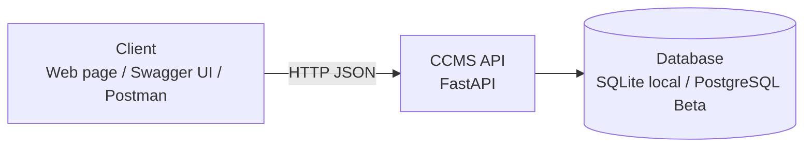
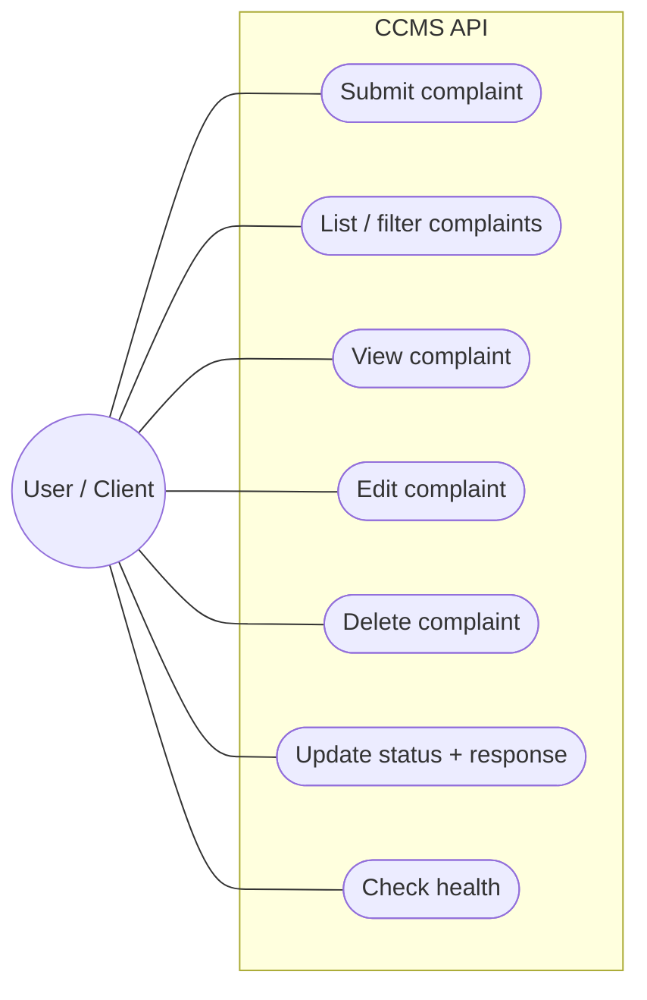
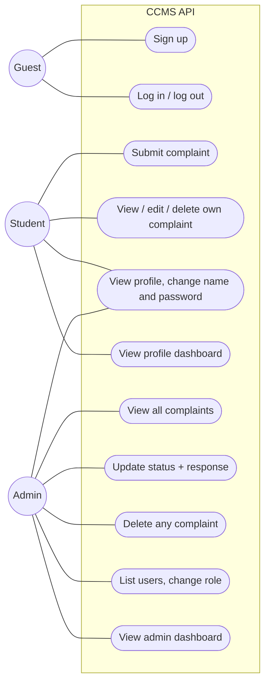
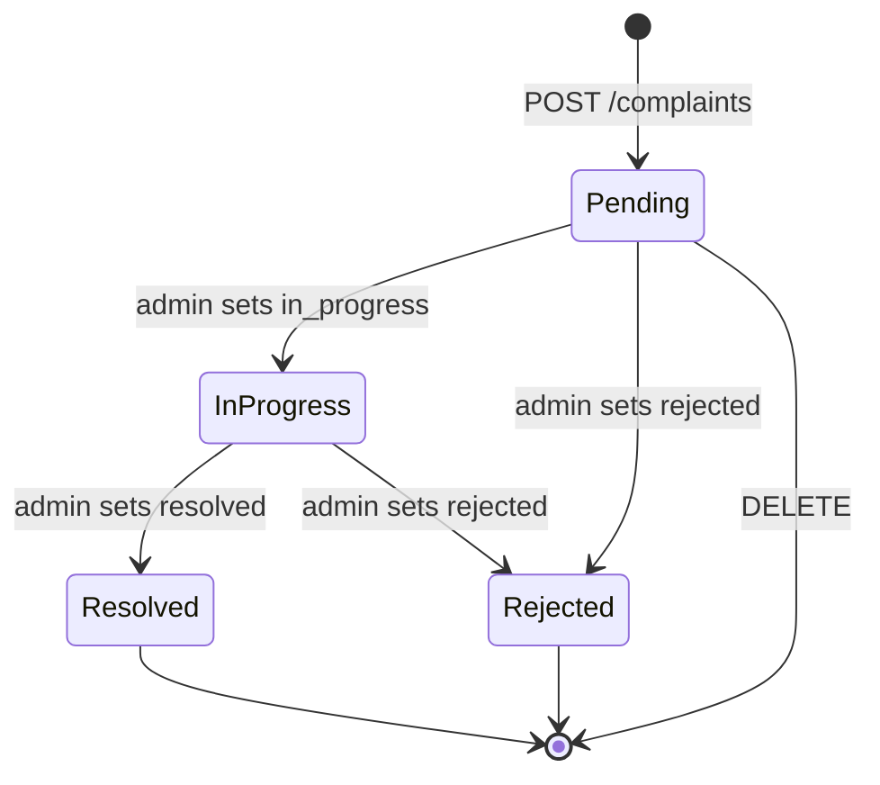

# Software Requirements Specification (SRS) — Campus Complaint Management System

| Field | Value |
|---|---|
| Product | Campus Complaint Management System (CCMS) |
| Version | MVP + Beta |
| Releases | MVP — Mid-term, Beta — Final |
| Status | Draft |
| Related docs | [Product Requirements Document (PRD)](01-prd.md), [Technical Design Document (TDD)](03-tdd.md) |

Every requirement has a **Release** column: **MVP** is built for the mid-term, **Beta** is added for the final.

**Documents in this set**

| Short form | Full form | Purpose | File |
|---|---|---|---|
| PRD | Product Requirements Document | What we build and why | [01-prd.md](01-prd.md) |
| SRS | Software Requirements Specification | Exact requirements, permissions and acceptance criteria (this document) | [02-srs.md](02-srs.md) |
| TDD | Technical Design Document | How we build it: architecture, data model, API | [03-tdd.md](03-tdd.md) |

## 1. Introduction

### 1.1 Purpose
This document lists the requirements for the Campus Complaint Management System: the MVP (complaint CRUD and status REST API, running locally) and the Beta (accounts, roles, scopes, dashboards, security and deployment).

### 1.2 Scope
- **MVP:** a client can submit, list, view, edit, delete and resolve complaints over HTTP. There are no accounts; all complaints are in one shared list.
- **Beta:** students sign up and log in, see only their own complaints, and admins handle all complaints, manage roles and see stats.
- Out of scope: see [PRD, section 5](01-prd.md#5-scope).

### 1.3 Definitions

| Term | Meaning |
|---|---|
| CRUD | Create, Read, Update, Delete |
| REST | API style where resources (like `complaints`) are accessed with HTTP methods (GET, POST, PATCH, DELETE) |
| Complaint | A problem report with a title, description, category, status and optional admin response |
| Category | One of `academic`, `hostel`, `library`, `cafeteria`, `transport`, `it_network`, `other` |
| Status | One of `pending`, `in_progress`, `resolved`, `rejected` |
| Admin response | Text written by an admin explaining the decision or action taken |
| RBAC | Role-Based Access Control: what a caller can do depends on their role |
| Scope | (Beta) A named permission, for example `complaint:status`; roles are mapped to scopes |
| JWT | JSON Web Token: a signed token that proves who the caller is |
| Access token | (Beta) Short-lived JWT sent in the `Authorization: Bearer` header |
| Refresh token | (Beta) Long-lived random token in an HttpOnly cookie, used to get a new access token |
| Client | Anything that calls the API: a web page, `/api/docs`, curl, Postman |
| OpenAPI | Standard API description; FastAPI generates it and shows it at `/api/docs` |

## 2. Overall description

### 2.1 System context

### 2.2 Users and roles

| Role | Release | Description |
|---|---|---|
| Anonymous client | MVP | Anyone who can reach the API; full access to the shared complaint list |
| Guest | Beta | Not logged in; can only sign up, log in, check health and read the API docs |
| Student | Beta | Logged in with role `student`; submits and manages own complaints, manages own profile |
| Admin | Beta | Logged in with role `admin`; sees all complaints, changes status and responds, deletes complaints, lists users, changes roles, sees stats |

`student` and `admin` are **global** roles stored on the user. Each role is mapped to a set of **scopes** (see [TDD, section 10.3](03-tdd.md#103-security-scopes-and-permission-dependencies)).

### 2.3 Use cases

**MVP**

**Beta**

### 2.4 Constraints
- C-1: MVP runs locally with SQLite; no external service is needed.
- C-2: Beta runs on Vercel serverless functions (no local disk that survives between requests).
- C-3: Backend in Python 3.10+ with FastAPI.
- C-4: All API routes start with `/api`, because `vercel.json` sends `/api/*` to the backend.
- C-5: Requests and responses use JSON.
- C-6: Production database is Supabase PostgreSQL; local development uses SQLite.
- C-7: (Beta) Login is implemented in our own API (no third-party login providers).

### 2.5 Assumptions
- A-1: (Beta) A hosted database is available to the Vercel project through an environment variable.
- A-2: The system is used for demos and class work, so traffic is low.
- A-3: (Beta) The first admin is promoted manually in the Supabase table editor.
- A-4: (Beta) MVP complaints are demo data and may be removed when complaints get a student owner.
- A-5: (Beta) A student is identified by their email address; no student-ID verification is done.

## 3. Functional requirements

### 3.1 Complaints — MVP

| ID | Requirement | Release | Story |
|---|---|---|---|
| FR-01 | The system shall create a complaint from a JSON body with `title`, `description` and `category` (all required). New complaints have status `pending`. | MVP | US-01 |
| FR-02 | The system shall return the list of complaints, newest first. | MVP | US-02 |
| FR-03 | The list shall support `offset` (default 0) and `limit` (default 20, max 100) query parameters. | MVP | US-02 |
| FR-04 | The list shall support optional `status` and `category` filters that can be combined. | MVP | US-03 |
| FR-05 | The system shall return one complaint by its ID. | MVP | US-04 |
| FR-06 | The system shall update `title`, `description` or `category` of a complaint only while its status is `pending`; otherwise it returns `409`. Fields not sent stay unchanged. | MVP | US-05 |
| FR-07 | The system shall delete a complaint only while its status is `pending`; otherwise it returns `409`. | MVP | US-06 |
| FR-08 | The system shall change a complaint's `status` following the state diagram (section 3.8) and store an optional `admin_response`. An invalid transition returns `409`. `admin_response` is required when the new status is `rejected`. | MVP | US-07 |
| FR-09 | The system shall set `created_at` when a complaint is created and update `updated_at` on every change. | MVP | US-01, US-05, US-07 |
| FR-10 | The system shall reject invalid input with status `422` and a message saying which field is wrong. | MVP | US-08 |
| FR-11 | The system shall return `404` when a complaint ID does not exist. | MVP | US-08 |
| FR-12 | The system shall expose `GET /api/health` returning `{"status": "ok"}`. | MVP | US-09 |
| FR-13 | The system shall publish interactive API docs at `/api/docs`. | MVP | US-08 |

### 3.2 Authentication and profile — Beta

| ID | Requirement | Release | Story |
|---|---|---|---|
| FR-14 | The system shall let a guest sign up with `email`, `name` and `password`. Email is unique (case-insensitive); a duplicate returns `409`. New users get role `student`. | Beta | US-10 |
| FR-15 | The system shall log a user in with email and password, returning an access token in the body and setting a refresh token cookie. Wrong email or wrong password returns `401` with the same message for both. | Beta | US-11 |
| FR-16 | The system shall issue a new access token when called with a valid refresh token cookie, and replace (rotate) the refresh token. | Beta | US-11 |
| FR-17 | The system shall log a user out by revoking the refresh token and clearing the cookie. | Beta | US-11 |
| FR-18 | The system shall return the logged-in user's profile (`id`, `email`, `name`, `role`, `created_at`). The password hash is never returned. | Beta | US-15 |
| FR-19 | A user shall be able to change their own `name`. Email and role cannot be changed through the profile. | Beta | US-15 |
| FR-20 | A user shall be able to change their password by sending the current and the new password. A wrong current password returns `400`. On success all the user's refresh tokens are revoked and they log in again. | Beta | US-15 |
| FR-21 | In the Beta, every complaint, profile, user and admin endpoint shall require a valid access token; otherwise it returns `401`. | Beta | US-12 |

### 3.3 Own complaints — Beta

| ID | Requirement | Release | Story |
|---|---|---|---|
| FR-22 | A complaint created through `/api/v1/complaints` shall belong to the logged-in student. A student's list returns only their own complaints. | Beta | US-12 |
| FR-23 | Reading, editing or deleting another student's complaint shall return `404`, so the complaint's existence is not revealed. | Beta | US-12 |

### 3.4 Roles (RBAC) and admin — Beta

| ID | Requirement | Release | Story |
|---|---|---|---|
| FR-24 | An admin shall be able to list and view all complaints (with the existing filters and pagination). | Beta | US-13 |
| FR-25 | Only an admin shall be able to change a complaint's status and admin response. A student calling that endpoint gets `403`. | Beta | US-14 |
| FR-26 | An admin shall be able to delete any complaint, in any status. | Beta | US-13 |
| FR-27 | An admin shall be able to list all users (paginated). | Beta | US-17 |
| FR-28 | An admin shall be able to change another user's role (`student` or `admin`). An admin cannot change their own role (`400`), so the system always keeps at least one admin. | Beta | US-17 |
| FR-29 | A non-admin calling an admin-only endpoint shall get `403`. | Beta | US-14, US-17, US-18 |

### 3.5 Dashboards — Beta

| ID | Requirement | Release | Story |
|---|---|---|---|
| FR-30 | The system shall provide a profile dashboard for the logged-in user: their profile plus their number of complaints in total and per status. | Beta | US-16 |
| FR-31 | An admin shall be able to view dashboard stats: total complaints, complaints per status, complaints per category, complaints created in the last 7 days, total users, admins, and new users in the last 7 days. | Beta | US-18 |

### 3.6 Security scopes and deployment — Beta

| ID | Requirement | Release | Story |
|---|---|---|---|
| FR-32 | The access token shall carry the caller's scopes (derived from the role), and every protected endpoint shall require a specific scope. A missing scope returns `403`. | Beta | US-14 |
| FR-33 | The system shall be reachable at a public URL, with `/api/docs` available. | Beta | US-20 |

### 3.7 Validation rules

| Field | Rule | Release |
|---|---|---|
| `title` | Required on create, string, 5–100 characters after trimming spaces | MVP |
| `description` | Required on create, string, 10–2000 characters after trimming spaces | MVP |
| `category` | Required on create, one of `academic`, `hostel`, `library`, `cafeteria`, `transport`, `it_network`, `other` | MVP |
| `status` | One of `pending`, `in_progress`, `resolved`, `rejected` | MVP |
| `admin_response` | Optional, max 1000 characters; required when status becomes `rejected` | MVP |
| `offset` | Integer ≥ 0 | MVP |
| `limit` | Integer 1–100 | MVP |
| `email` | Valid email, max 254 characters, stored lowercase | Beta |
| `name` (user) | 2–100 characters | Beta |
| `password` | 8–128 characters, at least one letter and one digit | Beta |
| `role` | `student` or `admin` | Beta |

### 3.8 Complaint states

A new complaint always starts as `pending`. `resolved` and `rejected` are final: they cannot change again. Edit and delete by a student are allowed only in `pending`. (In the Beta an admin can delete in any status, see FR-26.)

### 3.9 Permission matrix — Beta

| Action | Guest | Student | Admin |
|---|---|---|---|
| Sign up, log in, refresh | Yes | — | — |
| Log out, view own profile, change own name and password, profile dashboard | No | Yes | Yes |
| Submit a complaint | No | Yes | No (`403`) |
| List complaints | No | Own only | All |
| View one complaint | No | Own only (others `404`) | Any |
| Edit a complaint (only while `pending`) | No | Own only | No (`403`) |
| Delete a complaint | No | Own, only while `pending` | Any |
| Change status / write admin response | No | No (`403`) | Yes |
| List users, change a user's role | No | No (`403`) | Yes (not own role) |
| View admin dashboard stats | No | No (`403`) | Yes |

### 3.10 Status codes

| Case | Code | Release |
|---|---|---|
| Resource created | `201 Created` | MVP |
| Read or update succeeded | `200 OK` | MVP |
| Deleted / logged out / password changed | `204 No Content` | MVP |
| Validation failed | `422 Unprocessable Content` | MVP |
| Resource not found, or caller may not know it exists | `404 Not Found` | MVP |
| Action not allowed in the current state (edit/delete after `pending`, invalid status change) | `409 Conflict` | MVP |
| Unexpected server error | `500 Internal Server Error` | MVP |
| Bad request (e.g. admin changing own role, wrong current password) | `400 Bad Request` | Beta |
| Missing, invalid or expired token; wrong login | `401 Unauthorized` | Beta |
| Logged in but role or scope not allowed | `403 Forbidden` | Beta |
| Duplicate (email already registered) | `409 Conflict` | Beta |

## 4. Non-functional requirements

| ID | Category | Requirement | Release |
|---|---|---|---|
| NFR-01 | Performance | 95% of complaint requests answer in under 500 ms on a normal laptop or the deployed system (excluding a cold start). | MVP |
| NFR-02 | Persistence | Data is stored in a database and is not lost when the server restarts. | MVP |
| NFR-03 | Usability (setup) | A new developer can run the API locally by following the README, with no external service. | MVP |
| NFR-04 | Security | Database credentials and secrets are stored only in environment variables, never in Git. | MVP |
| NFR-05 | Security | Database queries use the ORM with parameters, never string-built SQL. | MVP |
| NFR-06 | Security | Error responses do not expose stack traces or database details. | MVP |
| NFR-07 | Maintainability | Code is split into layers: routes, schemas, models, services, database. | MVP |
| NFR-08 | Usability (API) | Every endpoint is listed in `/api/docs` with request and response schemas. | MVP |
| NFR-09 | Deployability | The Beta runs on Vercel; a push to `main` updates production. | Beta |
| NFR-10 | Security | All traffic uses HTTPS (provided by Vercel). | Beta |
| NFR-11 | Security | Passwords are hashed with Argon2; plain passwords are never stored, logged or returned. | Beta |
| NFR-12 | Security | Access tokens are JWTs signed with a secret of at least 32 bytes from an env var, valid for 15 minutes. | Beta |
| NFR-13 | Security | Refresh tokens are random, valid for 7 days, stored only as a hash, and replaced on every refresh. | Beta |
| NFR-14 | Security | The refresh token cookie is `HttpOnly`, `Secure`, `SameSite=Strict` and limited to path `/api/v1/auth`. | Beta |
| NFR-15 | Security | Frontend and API share one origin, so CORS stays disabled (no cross-origin access). | Beta |
| NFR-16 | Security | Responses include security headers: `X-Content-Type-Options`, `X-Frame-Options`, `Referrer-Policy`, `Strict-Transport-Security`. | Beta |
| NFR-17 | Security | Every permission and scope check runs on the server for every request; a frontend hiding a button is never the only protection. | Beta |
| NFR-18 | Security | Least privilege: each role gets only the scopes it needs. | Beta |
| NFR-19 | Performance | Sign up and login answer in under 1 s (password hashing is slow on purpose). | Beta |
| NFR-20 | Maintainability | Database schema changes are made through Alembic migrations, not by hand. | Beta |

## 5. Acceptance criteria

### MVP

**AC-01 Submit complaint (FR-01, FR-09)**
- Given a valid body `{"title": "Broken fan in room 204", "description": "The ceiling fan has not worked for a week.", "category": "hostel"}`
- When the client sends `POST /api/v1/complaints`
- Then the response is `201` with an `id`, `status: "pending"`, and `created_at` set.

**AC-02 Invalid complaint (FR-10)**
- Given a body with a title of 2 characters, or a category `"gym"`
- When the client sends `POST /api/v1/complaints`
- Then the response is `422` and mentions the wrong field.

**AC-03 List complaints (FR-02, FR-03)**
- Given 25 complaints exist
- When the client sends `GET /api/v1/complaints?limit=10&offset=0`
- Then the response is `200` with 10 complaints, newest first.

**AC-04 Filter complaints (FR-04)**
- Given 3 `pending` and 2 `resolved` complaints, 1 of the resolved ones in category `library`
- When the client sends `GET /api/v1/complaints?status=resolved&category=library`
- Then the response contains exactly that 1 complaint.

**AC-05 Get complaint (FR-05, FR-11)**
- Given complaint `5` exists
- When the client sends `GET /api/v1/complaints/5`, the response is `200` with that complaint.
- When the client sends `GET /api/v1/complaints/9999`, the response is `404`.

**AC-06 Edit pending complaint (FR-06, FR-09)**
- Given complaint `5` is `pending`
- When the client sends `PATCH /api/v1/complaints/5` with `{"title": "Broken fan in room 205"}`
- Then the response is `200`, the title is changed, the description is unchanged, and `updated_at` is newer.

**AC-07 Edit non-pending complaint (FR-06)**
- Given complaint `6` is `in_progress`
- When the client sends `PATCH /api/v1/complaints/6` with a new description
- Then the response is `409` and the complaint is unchanged.

**AC-08 Update status (FR-08)**
- Given complaint `5` is `pending`
- When the client sends `PATCH /api/v1/complaints/5/status` with `{"status": "in_progress"}`, the response is `200` with the new status.
- When the client then sends `{"status": "resolved", "admin_response": "Fan replaced."}`, the response is `200` with both values.

**AC-09 Invalid status change (FR-08)**
- Given complaint `7` is `resolved`
- When the client sends `PATCH /api/v1/complaints/7/status` with `{"status": "pending"}`, the response is `409`.
- When a `pending` complaint is set to `rejected` without an `admin_response`, the response is `422`.

**AC-10 Delete complaint (FR-07)**
- Given complaint `5` is `pending`
- When the client sends `DELETE /api/v1/complaints/5`
- Then the response is `204`, and a following `GET /api/v1/complaints/5` returns `404`.
- Given complaint `6` is `in_progress`, `DELETE /api/v1/complaints/6` returns `409`.

**AC-11 Health (FR-12)**
- When the client sends `GET /api/health`
- Then the response is `200` with `{"status": "ok"}`.

### Beta

**AC-12 Sign up (FR-14)**
- Given no account exists for `a@x.com`
- When a guest signs up with that email, the response is `201` with role `student` and no password field.
- When anyone signs up again with `A@x.com`, the response is `409`.

**AC-13 Log in (FR-15)**
- Given user `a@x.com` exists
- When they log in with the right password, the response is `200` with an `access_token`, and a `refresh_token` cookie is set.
- When they log in with a wrong password, the response is `401`.

**AC-14 Token required (FR-21)**
- When a client calls `GET /api/v1/complaints` without a token, or with an expired one
- Then the response is `401`.

**AC-15 Private complaints (FR-22, FR-23)**
- Given student A owns complaint `5`
- When student B sends `GET`, `PATCH` or `DELETE /api/v1/complaints/5`
- Then the response is `404`, and A's complaint is unchanged.
- When B lists complaints, complaint `5` is not in the list.

**AC-16 Student cannot change status (FR-25, FR-32)**
- Given a logged-in student
- When they send `PATCH /api/v1/complaints/5/status`
- Then the response is `403`.

**AC-17 Admin sees all and responds (FR-24, FR-25)**
- Given complaints from several students
- When an admin lists complaints, they see all of them.
- When the admin sets status `resolved` with a response, the response is `200`, and the owning student sees the new status and response.

**AC-18 Admin only users (FR-27, FR-29)**
- When a `student` calls `GET /api/v1/admin/users`, the response is `403`.
- When an `admin` calls it, the response is `200` with the user list.

**AC-19 Change role (FR-28)**
- When an admin sets user B's role to `admin`, the response is `200` and B can now call admin endpoints.
- When an admin tries to change their own role, the response is `400`.

**AC-20 Profile dashboard (FR-30)**
- Given a student with 4 complaints (2 `pending`, 1 `resolved`, 1 `rejected`)
- When they send `GET /api/v1/users/me/dashboard`
- Then the response is `200` with `total = 4`, `pending = 2`, `in_progress = 0`, `resolved = 1`, `rejected = 1`.

**AC-21 Admin dashboard stats (FR-31)**
- Given 10 users (2 admins) and 40 complaints (15 `resolved`)
- When an admin sends `GET /api/v1/admin/stats`
- Then the response is `200` with `users.total = 10`, `users.admins = 2`, `complaints.total = 40` and `complaints.by_status.resolved = 15`.
- When a `student` sends it, the response is `403`.

**AC-22 Edit profile and change password (FR-19, FR-20)**
- When a user sends `PATCH /api/v1/users/me` with `{"name": "Sakib A."}`, the response is `200` with the new name; `email` and `role` are unchanged.
- When they send the wrong `current_password`, the response is `400`.
- When they send the right one and a valid `new_password`, the response is `204`, their refresh token no longer works, and they can log in only with the new password.

**AC-23 Admin deletes any complaint (FR-26)**
- Given complaint `6` is `in_progress` and owned by a student
- When an admin sends `DELETE /api/v1/complaints/6`, the response is `204`.
- When the owning student sends the same request, the response is `409`.

**AC-24 Scope enforced (FR-32)**
- Given an access token that does not contain the scope `complaint:status`
- When it is used on `PATCH /api/v1/complaints/{id}/status`
- Then the response is `403`.

## 6. Traceability

| Story | Requirements | Endpoint (see [TDD, section 6](03-tdd.md#6-rest-api-design)) | Release |
|---|---|---|---|
| US-01 | FR-01, FR-09 | `POST /api/v1/complaints` | MVP |
| US-02 | FR-02, FR-03 | `GET /api/v1/complaints` | MVP |
| US-03 | FR-04 | `GET /api/v1/complaints?status=&category=` | MVP |
| US-04 | FR-05 | `GET /api/v1/complaints/{id}` | MVP |
| US-05 | FR-06, FR-09 | `PATCH /api/v1/complaints/{id}` | MVP |
| US-06 | FR-07 | `DELETE /api/v1/complaints/{id}` | MVP |
| US-07 | FR-08, FR-09 | `PATCH /api/v1/complaints/{id}/status` | MVP |
| US-08 | FR-10, FR-11, FR-13 | All, `/api/docs` | MVP |
| US-09 | FR-12 | `GET /api/health` | MVP |
| US-10 | FR-14 | `POST /api/v1/auth/signup` | Beta |
| US-11 | FR-15, FR-16, FR-17 | `/api/v1/auth/login`, `/refresh`, `/logout` | Beta |
| US-12 | FR-21, FR-22, FR-23 | `/api/v1/complaints` (all) | Beta |
| US-13 | FR-24, FR-26 | `GET /api/v1/complaints`, `DELETE /api/v1/complaints/{id}` | Beta |
| US-14 | FR-25, FR-29, FR-32 | `PATCH /api/v1/complaints/{id}/status` | Beta |
| US-15 | FR-18, FR-19, FR-20 | `GET` / `PATCH /api/v1/users/me`, `POST /api/v1/users/me/password` | Beta |
| US-16 | FR-30 | `GET /api/v1/users/me/dashboard` | Beta |
| US-17 | FR-27, FR-28, FR-29 | `GET /api/v1/admin/users`, `PATCH /api/v1/admin/users/{id}/role` | Beta |
| US-18 | FR-29, FR-31 | `GET /api/v1/admin/stats` | Beta |
| US-19 | NFR-11, NFR-12, NFR-13, NFR-14 | `POST /api/v1/auth/login`, `POST /api/v1/auth/signup` | Beta |
| US-20 | FR-33, NFR-09, NFR-10 | Public URL, `/api/docs`, `GET /api/health` | Beta |
