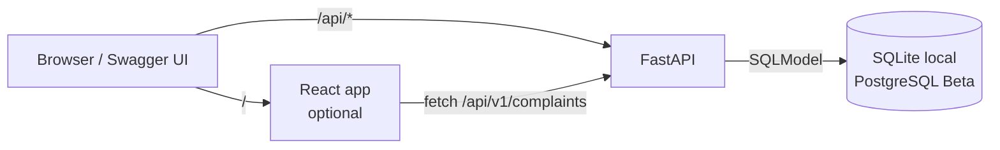
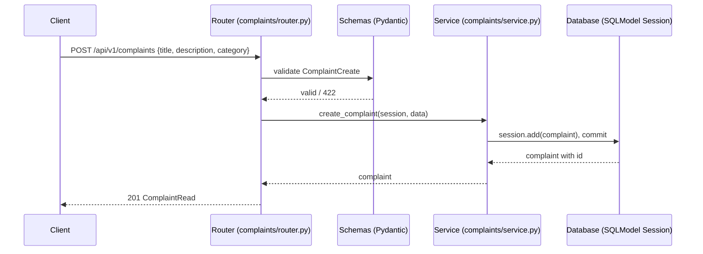
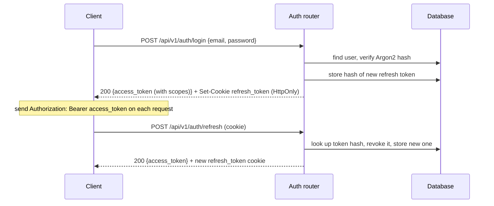
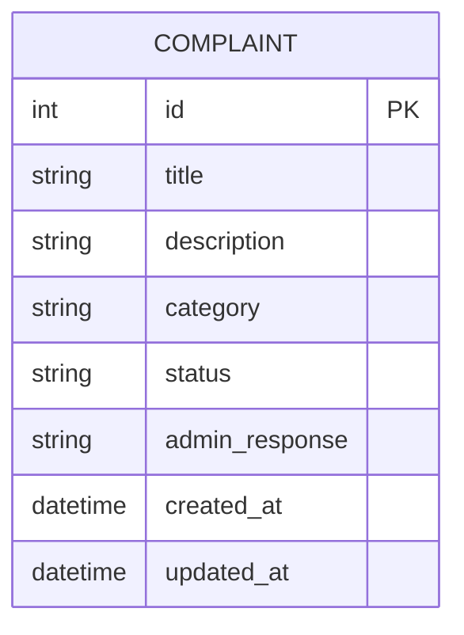
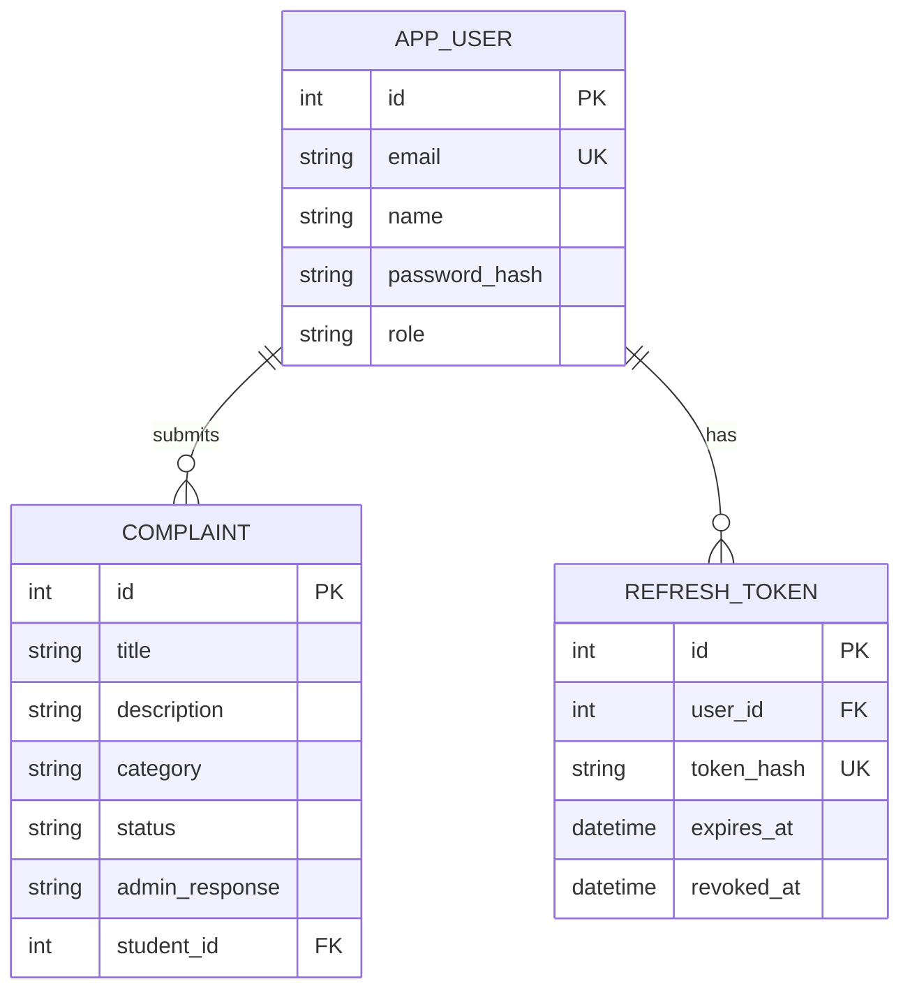
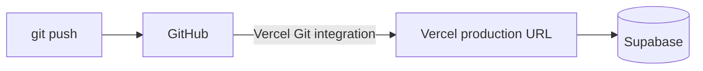

# Technical Design Document (TDD) — Campus Complaint Management System

| Field | Value |
|---|---|
| Product | Campus Complaint Management System (CCMS) |
| Version | MVP + Beta |
| Releases | MVP — Mid-term, Beta — Final |
| Status | Draft |
| Related docs | [Product Requirements Document (PRD)](01-prd.md), [Software Requirements Specification (SRS)](02-srs.md) |

Sections and tables are marked **MVP** or **Beta**. Build the MVP parts for the mid-term; the Beta parts extend them for the final.

**Documents in this set**

| Short form | Full form | Purpose | File |
|---|---|---|---|
| PRD | Product Requirements Document | What we build and why | [01-prd.md](01-prd.md) |
| SRS | Software Requirements Specification | Exact requirements, permissions and acceptance criteria | [02-srs.md](02-srs.md) |
| TDD | Technical Design Document | How we build it: architecture, data model, API (this document) | [03-tdd.md](03-tdd.md) |

## 1. Overview

- **MVP:** a FastAPI REST API for complaint CRUD and status updates, stored in a SQL database through SQLModel (SQLite locally). The demo is done from the interactive docs at `/api/docs`.
- **Beta:** the same app gains users and login (JWT), global roles (`student` / `admin`), security scopes, profile and admin dashboards, and security hardening. Schema changes are managed with Alembic. The app is deployed to Vercel with Supabase PostgreSQL.

## 2. Tech stack

| Layer | Choice | Why | Release |
|---|---|---|---|
| API | FastAPI | Validation, OpenAPI docs and type hints out of the box | MVP |
| ORM / models | SQLModel | One class works as both the Pydantic schema and the database table | MVP |
| Database (local) | SQLite | No setup needed | MVP |
| Frontend (optional) | Vite + React + TypeScript | Simple page(s) that call the API | MVP (Could), Beta (Could) |
| Database (production) | PostgreSQL on Supabase | Free tier, managed Postgres with a web dashboard and connection pooler for serverless | Beta |
| DB driver | `psycopg[binary]` (psycopg 3) | Standard Postgres driver for SQLAlchemy/SQLModel | Beta |
| Hosting | Vercel | Frontend and backend in one project (`vercel.json`), auto deploy from GitHub | Beta |
| Migrations | Alembic | Versioned schema changes as the model grows from 1 to 3 tables | Beta |
| JWT | PyJWT | Sign and verify access tokens | Beta |
| Password hashing | `pwdlib[argon2]` | Argon2 hashing, recommended in the FastAPI docs | Beta |

## 3. Architecture



All backend routes start with `/api` (on Vercel, `vercel.json` sends `/api/*` to the backend). For the same reason the API docs are served at `/api/docs` (not FastAPI's default `/docs`):

```python
app = FastAPI(title="CCMS API", docs_url="/api/docs", openapi_url="/api/openapi.json", redoc_url=None)
```

### 3.1 Request flow — MVP



### 3.2 Login and refresh flow — Beta



## 4. Project structure

```
backend/
  main.py              # creates the app, includes each feature's router, health check, catch-all 500 handler
  app/
    config.py          # settings from env vars (DATABASE_URL; Beta: JWT secret, token lifetimes)
    database.py        # engine, get_session(), SessionDep, create_db_and_tables()
    security.py        # (Beta) password hashing, JWT create/verify, refresh tokens, scope table
    complaints/        # one folder per feature (domain), everything for complaints together
      router.py        # /api/v1/complaints endpoints (APIRouter)
      schemas.py       # ComplaintCreate / ComplaintUpdate / StatusUpdate / ComplaintRead
      models.py        # Complaint table, Category and Status enums
      service.py       # business rules (status transitions, pending-only edit) and database queries
      dependencies.py  # valid_complaint: resolves {complaint_id} to a Complaint or answers 404
    auth/              # (Beta) router, schemas, models (AppUser, RefreshToken), service, dependencies (get_current_user, require_scope)
    users/             # (Beta) /api/v1/users/me (profile, change name, change password, dashboard)
    admin/             # (Beta) /api/v1/admin/* (users, role change, stats)
  alembic/             # (Beta) migration scripts
  alembic.ini          # (Beta)
  requirements.txt
frontend/              # (optional) Vite + React + TypeScript
  src/
    pages/             # (Beta) Login, Signup, MyComplaints, Profile, AdminDashboard
    services/          # api.ts (every backend call)
docs/
  01-prd.md
  02-srs.md
  03-tdd.md
```

The backend is organised by feature (domain): each folder holds its own router, schemas, models, service and dependencies. A **router** parses the request and calls the service; **dependencies** (`Depends`) do reusable checks, such as loading a complaint or answering `404`, and later the permission checks; the **service** holds the business rules and database queries through the SQLModel session and knows nothing about HTTP. `main.py` only wires the routers together and adds the catch-all `500` handler.

## 5. Data model

### 5.1 `complaint` table — MVP

| Column | Type | Rules |
|---|---|---|
| `id` | integer | Primary key, auto increment |
| `title` | varchar(100) | Not null |
| `description` | varchar(2000) | Not null |
| `category` | varchar(20) | Not null, one of the categories in SRS 1.3 |
| `status` | varchar(15) | Not null, default `pending` |
| `admin_response` | varchar(1000) | Nullable |
| `created_at` | timestamp (UTC) | Not null, set on insert |
| `updated_at` | timestamp (UTC) | Not null, set on insert and every update |



### 5.2 Full data model — Beta

`user` is a reserved word in PostgreSQL, so the table is named `app_user`.

**`app_user`**

| Column | Type | Rules |
|---|---|---|
| `id` | integer | Primary key |
| `email` | varchar(254) | Unique, stored lowercase |
| `name` | varchar(100) | Not null |
| `password_hash` | varchar | Argon2 hash, never returned by the API |
| `role` | varchar(10) | `student` or `admin`, default `student` |
| `created_at`, `updated_at` | timestamp (UTC) | Not null |

**`refresh_token`**

| Column | Type | Rules |
|---|---|---|
| `id` | integer | Primary key |
| `user_id` | integer | FK → `app_user.id`, on delete cascade |
| `token_hash` | char(64) | SHA-256 of the token, unique |
| `expires_at` | timestamp (UTC) | Not null (now + 7 days) |
| `revoked_at` | timestamp (UTC) | Nullable |
| `created_at` | timestamp (UTC) | Not null |

**`complaint` (new column in Beta)**

| Column | Type | Rules |
|---|---|---|
| `student_id` | integer | FK → `app_user.id`, not null: the student who submitted the complaint |

Indexes: `complaint(student_id)`, `complaint(status)`, `complaint(category)`, `refresh_token(user_id)`.



**Who can see a complaint:**
- A student: only complaints where `student_id` is their own id.
- An admin: every complaint.

### 5.3 Schemas

| Schema | Used for | Fields | Release |
|---|---|---|---|
| `ComplaintCreate` | `POST` complaint body | `title`, `description`, `category` | MVP |
| `ComplaintUpdate` | `PATCH` complaint body | all optional: `title`, `description`, `category` | MVP |
| `StatusUpdate` | `PATCH` status body | `status`, `admin_response?` | MVP |
| `ComplaintRead` | Complaint responses | all complaint columns (Beta adds `student_id`) | MVP |
| `SignupRequest` | Sign up | `email`, `name`, `password` | Beta |
| `LoginRequest` | Log in | `email`, `password` | Beta |
| `TokenResponse` | Login / refresh | `access_token`, `token_type: "bearer"`, `expires_in` | Beta |
| `UserRead` | User responses | `id`, `email`, `name`, `role`, `created_at` (never `password_hash`) | Beta |
| `ProfileUpdate` | Change own name | `name` | Beta |
| `PasswordChange` | Change own password | `current_password`, `new_password` | Beta |
| `RoleUpdate` | Change role | `role` | Beta |
| `ProfileDashboard` | Profile dashboard | `user: UserRead`, `complaints {total, pending, in_progress, resolved, rejected}` | Beta |
| `AdminStats` | Admin dashboard | `users {total, admins, new_last_7_days}`, `complaints {total, by_status, by_category, created_last_7_days}` | Beta |

MVP sketch:

```python
class Category(str, Enum):
    academic = "academic"; hostel = "hostel"; library = "library"; cafeteria = "cafeteria"
    transport = "transport"; it_network = "it_network"; other = "other"

class Status(str, Enum):
    pending = "pending"; in_progress = "in_progress"; resolved = "resolved"; rejected = "rejected"

class ComplaintBase(SQLModel):
    title: str = Field(min_length=5, max_length=100)
    description: str = Field(min_length=10, max_length=2000)
    category: Category

class Complaint(ComplaintBase, table=True):
    id: int | None = Field(default=None, primary_key=True)
    status: Status = Status.pending
    admin_response: str | None = Field(default=None, max_length=1000)
    created_at: datetime = Field(default_factory=lambda: datetime.now(timezone.utc))
    updated_at: datetime = Field(default_factory=lambda: datetime.now(timezone.utc))

class ComplaintCreate(ComplaintBase): ...

class ComplaintUpdate(SQLModel):
    title: str | None = Field(default=None, min_length=5, max_length=100)
    description: str | None = Field(default=None, min_length=10, max_length=2000)
    category: Category | None = None

class StatusUpdate(SQLModel):
    status: Status
    admin_response: str | None = Field(default=None, max_length=1000)
```

`title` and `description` are trimmed before validation so spaces-only values are rejected.

Allowed status changes (checked in `service.py`):

```python
ALLOWED = {
    Status.pending: {Status.in_progress, Status.rejected},
    Status.in_progress: {Status.resolved, Status.rejected},
    Status.resolved: set(),
    Status.rejected: set(),
}
```

## 6. REST API design

Base path: `/api/v1`. All bodies are JSON.

### 6.1 Endpoints — MVP

In the MVP no login is needed. In the Beta the same complaint endpoints require a token and a scope (see section 6.2).

| Method | Path | Body | Success | Errors | FR |
|---|---|---|---|---|---|
| `POST` | `/api/v1/complaints` | `ComplaintCreate` | `201` `ComplaintRead` | `422` | FR-01, FR-09, FR-10 |
| `GET` | `/api/v1/complaints?status=&category=&offset=0&limit=20` | — | `200` `ComplaintRead[]` | `422` | FR-02, FR-03, FR-04 |
| `GET` | `/api/v1/complaints/{id}` | — | `200` `ComplaintRead` | `404` | FR-05, FR-11 |
| `PATCH` | `/api/v1/complaints/{id}` | `ComplaintUpdate` | `200` `ComplaintRead` | `404`, `409` (not pending), `422` | FR-06 |
| `DELETE` | `/api/v1/complaints/{id}` | — | `204` | `404`, `409` (not pending) | FR-07 |
| `PATCH` | `/api/v1/complaints/{id}/status` | `StatusUpdate` | `200` `ComplaintRead` | `404`, `409` (invalid change), `422` | FR-08 |
| `GET` | `/api/health` | — | `200` `{"status":"ok"}` | — | FR-12 |

### 6.2 Endpoints — Beta

"Who" uses the roles from the [SRS permission matrix (section 3.9)](02-srs.md#39-permission-matrix--beta). Every endpoint except auth, health and docs needs `Authorization: Bearer <access_token>` (`401` without it) and the listed **scope** (`403` without it).

**Auth**

| Method | Path | Who | Body | Success | Errors | FR |
|---|---|---|---|---|---|---|
| `POST` | `/api/v1/auth/signup` | Guest | `SignupRequest` | `201` `UserRead` | `409`, `422` | FR-14 |
| `POST` | `/api/v1/auth/login` | Guest | `LoginRequest` | `200` `TokenResponse` + cookie | `401` | FR-15 |
| `POST` | `/api/v1/auth/refresh` | Refresh cookie | — | `200` `TokenResponse` + new cookie | `401` | FR-16 |
| `POST` | `/api/v1/auth/logout` | Refresh cookie | — | `204`, cookie cleared | — | FR-17 |

**Profile and dashboard**

| Method | Path | Who | Scope | Body | Success | Errors | FR |
|---|---|---|---|---|---|---|---|
| `GET` | `/api/v1/users/me` | Student, Admin | `profile:manage` | — | `200` `UserRead` | `401` | FR-18 |
| `PATCH` | `/api/v1/users/me` | Student, Admin | `profile:manage` | `ProfileUpdate` | `200` `UserRead` | `422` | FR-19 |
| `POST` | `/api/v1/users/me/password` | Student, Admin | `profile:manage` | `PasswordChange` | `204` (all sessions logged out) | `400` (wrong current password), `422` | FR-20 |
| `GET` | `/api/v1/users/me/dashboard` | Student, Admin | `profile:manage` | — | `200` `ProfileDashboard` | `401` | FR-30 |

**Complaints** — same six endpoints as the MVP, now protected:

| Method | Path | Who | Scope | Beta behaviour | FR |
|---|---|---|---|---|---|
| `POST` | `/api/v1/complaints` | Student | `complaint:create` | Complaint is linked to the caller; admin gets `403` | FR-22 |
| `GET` | `/api/v1/complaints` | Student, Admin | `complaint:read:own` or `complaint:read:all` | Student: own only. Admin: all | FR-22, FR-24 |
| `GET` | `/api/v1/complaints/{id}` | Student, Admin | `complaint:read:own` or `complaint:read:all` | Student: own only, others `404`. Admin: any | FR-23, FR-24 |
| `PATCH` | `/api/v1/complaints/{id}` | Student (own) | `complaint:update:own` | Only while `pending` (`409` otherwise); others' complaint `404`; admin `403` | FR-06, FR-23 |
| `DELETE` | `/api/v1/complaints/{id}` | Student (own), Admin | `complaint:delete:own` or `complaint:delete:any` | Student: own and `pending` only (`409` otherwise). Admin: any | FR-07, FR-26 |
| `PATCH` | `/api/v1/complaints/{id}/status` | Admin | `complaint:status` | Student gets `403` | FR-08, FR-25, FR-32 |

**Admin**

| Method | Path | Who | Scope | Body | Success | Errors | FR |
|---|---|---|---|---|---|---|---|
| `GET` | `/api/v1/admin/users?offset&limit` | Admin | `user:read` | — | `200` `UserRead[]` | `403` | FR-27 |
| `PATCH` | `/api/v1/admin/users/{user_id}/role` | Admin | `user:role` | `RoleUpdate` | `200` `UserRead` | `400` (own role), `403`, `404` | FR-28 |
| `GET` | `/api/v1/admin/stats` | Admin | `stats:read` | — | `200` `AdminStats` | `403` | FR-31 |

### 6.3 Examples

Submit:

```http
POST /api/v1/complaints
Content-Type: application/json

{ "title": "Broken fan in room 204", "description": "The ceiling fan has not worked for a week.", "category": "hostel" }
```

```http
201 Created

{
  "id": 1,
  "title": "Broken fan in room 204",
  "description": "The ceiling fan has not worked for a week.",
  "category": "hostel",
  "status": "pending",
  "admin_response": null,
  "created_at": "2026-10-13T10:00:00Z",
  "updated_at": "2026-10-13T10:00:00Z"
}
```

Resolve (admin):

```http
PATCH /api/v1/complaints/1/status
Content-Type: application/json

{ "status": "in_progress" }
```

Log in (Beta):

```http
POST /api/v1/auth/login
Content-Type: application/json

{ "email": "a@x.com", "password": "correct horse 42" }
```

```http
200 OK
Set-Cookie: refresh_token=...; HttpOnly; Secure; SameSite=Strict; Path=/api/v1/auth; Max-Age=604800

{ "access_token": "eyJhbGciOi...", "token_type": "bearer", "expires_in": 900 }
```

### 6.4 Error format

Use FastAPI's default format so there is no custom code to maintain:

```json
{ "detail": "Complaint not found" }
```

Validation errors (`422`) use FastAPI's built-in list format, which names the failing field:

```json
{ "detail": [ { "loc": ["body", "title"], "msg": "String should have at least 5 characters", "type": "string_too_short" } ] }
```

A catch-all exception handler returns `500` with `{"detail": "Internal server error"}` and logs the real error (NFR-06).

### 6.5 Design rules
- Plural nouns for resources (`/complaints`, `/users`), no verbs in paths (except the `auth` actions and the `/status` sub-resource).
- `PATCH` for partial update; only fields sent are changed (`model_dump(exclude_unset=True)`).
- Lists are ordered by `created_at` descending and take `offset` / `limit`.
- `404` (not `403`) when the caller is not allowed to know a resource exists; `403` when they can see it but not do the action.
- `409` when the request is valid but not allowed in the complaint's current state.
- `/api/v1` prefix so a future `v2` of the API can live next to it.

## 7. Database access

- `database.py` creates one engine from `settings.database_url` (the `DATABASE_URL` env var, defaulting to `backend/ccms.db` locally).
- `get_session()` is a FastAPI dependency that yields a `Session` per request.
- MVP: tables are created on startup with `SQLModel.metadata.create_all(engine)`.
- Beta: `create_all` is removed and the schema is managed by Alembic (section 12).
- On Vercel, connect through Supabase's **transaction pooler** (port `6543`), because each serverless function opens its own connections.
- The transaction pooler does not support prepared statements, so the engine is created with `poolclass=NullPool` and `connect_args={"prepare_threshold": None}` for psycopg.
- URL format: `postgresql+psycopg://postgres.<project-ref>:<password>@aws-0-<region>.pooler.supabase.com:6543/postgres`.
- Only the Postgres database of Supabase is used. Supabase Auth, Storage and the auto-generated REST API are not used; login is our own (section 10) and all access goes through our FastAPI backend.
- Row Level Security (RLS) is not used because the browser never talks to Supabase directly; permissions are enforced in FastAPI. Keep the Supabase `anon` and `service_role` keys out of any frontend.

## 8. Configuration

| Variable | Local | Production (Vercel) | Release |
|---|---|---|---|
| `DATABASE_URL` | not set (SQLite default) | Supabase transaction pooler URL (port `6543`) | MVP (optional), Beta |
| `JWT_SECRET` | any long random string in `.env` | Random 32+ byte secret (`python -c "import secrets; print(secrets.token_urlsafe(48))"`) | Beta |
| `ACCESS_TOKEN_MINUTES` | `15` | `15` | Beta |
| `REFRESH_TOKEN_DAYS` | `7` | `7` | Beta |
| `MIGRATION_DATABASE_URL` | not needed | Not on Vercel. Used only on a developer machine to run Alembic against Supabase (session pooler, port `5432`) | Beta |

No secrets are committed. `.env` stays in `.gitignore`; commit only a `.env.example` with empty values.

Supabase setup (one time, Beta):
1. Create a project at supabase.com and save the database password.
2. **Connect** → **Transaction pooler** → copy the URI, and change the scheme to `postgresql+psycopg://`.
3. In Vercel → Project → **Settings** → **Environment Variables**, add it as `DATABASE_URL`.
4. Add `psycopg[binary]` to `backend/requirements.txt`.

Free-tier Supabase projects pause after a week with no activity; open the dashboard and restore the project before the demo if needed.

## 9. Deployment — Beta



- The MVP is not deployed; it runs locally (`uvicorn`), and the demo uses `/api/docs`.
- For the Beta, connect the GitHub repo to Vercel with the Vercel GitHub integration; a push to `main` deploys to production.
- Environment variables from section 8 are set in the Vercel project settings.
- Before merging a change that includes a new migration, run `alembic upgrade head` against Supabase (section 12), then merge so Vercel deploys the matching code.

## 10. Auth, RBAC and scopes design — Beta

### 10.1 Tokens

| Token | Format | Lifetime | Where it lives |
|---|---|---|---|
| Access token | JWT, HS256, claims `sub` (user id), `role`, `scope`, `iat`, `exp` | 15 min | Frontend memory; sent as `Authorization: Bearer` |
| Refresh token | Random 32 bytes (`secrets.token_urlsafe`) | 7 days | `refresh_token` cookie (`HttpOnly`, `Secure`, `SameSite=Strict`, `Path=/api/v1/auth`); DB keeps only its SHA-256 hash |

- **Refresh rotation:** each refresh revokes the old token and issues a new one. If a revoked token is used again, all of that user's refresh tokens are revoked (it was probably stolen).
- **Logout:** revokes the current refresh token and clears the cookie. The access token simply expires within 15 minutes.
- The `role` and `scope` claims are used for convenience; permission checks also use the role loaded from the database, so a role change applies on the next request.

### 10.2 Passwords

- Hash with `pwdlib` (Argon2). Verify on login; never log or return the hash.
- Unknown email and wrong password both return `401 "Invalid email or password"`, so emails cannot be discovered.
- Password rules: 8–128 characters, at least one letter and one digit.

### 10.3 Security scopes and permission dependencies

Each role is mapped to a fixed set of scopes. At login the scopes of the user's role are written into the access token (`scope` claim, space-separated).

| Scope | Student | Admin | Allows |
|---|---|---|---|
| `complaint:create` | Yes | No | Submit a complaint |
| `complaint:read:own` | Yes | No | List and view own complaints |
| `complaint:read:all` | No | Yes | List and view every complaint |
| `complaint:update:own` | Yes | No | Edit own complaint while `pending` |
| `complaint:delete:own` | Yes | No | Delete own complaint while `pending` |
| `complaint:delete:any` | No | Yes | Delete any complaint |
| `complaint:status` | No | Yes | Change status and admin response |
| `profile:manage` | Yes | Yes | View/edit own profile, change password, own dashboard |
| `user:read` | No | Yes | List users |
| `user:role` | No | Yes | Change a user's role |
| `stats:read` | No | Yes | Admin dashboard stats |

Permissions are FastAPI dependencies, so each route declares what it needs:

```python
bearer = HTTPBearer()

ROLE_SCOPES = {
    "student": {"complaint:create", "complaint:read:own", "complaint:update:own",
                "complaint:delete:own", "profile:manage"},
    "admin": {"complaint:read:all", "complaint:delete:any", "complaint:status",
              "profile:manage", "user:read", "user:role", "stats:read"},
}

def get_current_user(creds=Depends(bearer), session: Session = Depends(get_session)) -> AppUser:
    payload = decode_access_token(creds.credentials)   # 401 if invalid or expired
    user = session.get(AppUser, int(payload["sub"]))
    if user is None:
        raise HTTPException(401, "Invalid token")
    user.token_scopes = set(payload.get("scope", "").split())
    return user

def require_scope(scope: str):
    def checker(user: AppUser = Depends(get_current_user)) -> AppUser:
        # the scope must be in the token AND still allowed for the user's current role
        if scope not in user.token_scopes or scope not in ROLE_SCOPES[user.role]:
            raise HTTPException(403, "Not allowed")
        return user
    return checker
```

| Route | Dependency |
|---|---|
| `POST /complaints` | `require_scope("complaint:create")` |
| `PATCH /complaints/{id}/status` | `require_scope("complaint:status")` |
| `PATCH /complaints/{id}` | `require_scope("complaint:update:own")` |
| `/users/me/*` | `require_scope("profile:manage")` |
| `/admin/users`, `/admin/users/{id}/role`, `/admin/stats` | `require_scope("user:read")`, `("user:role")`, `("stats:read")` |

Rules that depend on the data are checked inside the service:
- `GET /complaints`: if the user has `complaint:read:all` return all; else if `complaint:read:own` filter by `student_id == user.id`; else `403`. `GET /complaints/{id}` follows the same rule; a student's request for someone else's complaint returns `404`.
- `DELETE /complaints/{id}`: with `complaint:delete:any` delete in any status; with `complaint:delete:own` allow only when `student_id == user.id` and status is `pending` (`409` if not pending, `404` if not theirs).
- Change role: `user_id == caller` → `400`.
- Change password: verify `current_password` (`400` if wrong), hash `new_password`, revoke all the user's refresh tokens; the client then logs in again.

### 10.4 Dashboards

Profile dashboard (`GET /users/me/dashboard`): one `GROUP BY status` query on the caller's complaints (`student_id == me`), filled into all four statuses (missing ones are `0`), plus the `UserRead` of the caller. For an admin, the `complaints` counts are of complaints they submitted themselves (normally 0); the admin overview is the admin stats endpoint.

Admin stats (`GET /admin/stats`): plain `COUNT` queries, no extra tables:

```python
week_ago = datetime.now(timezone.utc) - timedelta(days=7)
stats = AdminStats(
    users={
        "total": count(AppUser),
        "admins": count(AppUser, AppUser.role == "admin"),
        "new_last_7_days": count(AppUser, AppUser.created_at >= week_ago),
    },
    complaints={
        "total": count(Complaint),
        "by_status": group_count(Complaint.status),        # {"pending": 12, "in_progress": 3, ...}
        "by_category": group_count(Complaint.category),    # {"hostel": 9, "library": 4, ...}
        "created_last_7_days": count(Complaint, Complaint.created_at >= week_ago),
    },
)
```

`count(model, *filters)` is a small helper around `select(func.count()).select_from(model).where(*filters)`; `group_count(column)` wraps `select(column, func.count()).group_by(column)`.

## 11. Security — Beta

| Area | Design |
|---|---|
| Passwords | Argon2 via `pwdlib`, minimum 8 characters |
| Tokens | Section 10.1; `JWT_SECRET` only in env vars |
| Scopes / RBAC | Section 10.3; every protected route uses `require_scope`; checked on the server for every request |
| Cookies | `HttpOnly`, `Secure`, `SameSite=Strict`, path-limited |
| CORS | Not enabled: frontend and API share the same origin; locally Vite proxies `/api` |
| Security headers | Added for all routes in `vercel.json` (below) |
| Injection | SQLModel/SQLAlchemy parameterised queries only |
| Errors | Catch-all handler returns a generic `500`; details only in logs |
| Data exposure | Response schemas (`UserRead`, `ComplaintRead`) list fields explicitly; `password_hash` and token hashes are never in a response schema |

```json
"headers": [
  {
    "source": "/(.*)",
    "headers": [
      { "key": "X-Content-Type-Options", "value": "nosniff" },
      { "key": "X-Frame-Options", "value": "DENY" },
      { "key": "Referrer-Policy", "value": "strict-origin-when-cross-origin" },
      { "key": "Strict-Transport-Security", "value": "max-age=63072000; includeSubDomains" }
    ]
  }
]
```

## 12. Migrations — Beta

- Add Alembic in `backend/alembic/`, with `target_metadata = SQLModel.metadata`.
- Revision `0001_mvp`: the MVP `complaint` table. On a database already created by `create_all`, run `alembic stamp 0001_mvp` once instead of upgrading.
- Revision `0002_beta`: create `app_user` and `refresh_token`; delete existing MVP demo complaints (they have no owner); add `student_id` (not null) and the indexes to `complaint`.
- Run migrations from a developer machine: `MIGRATION_DATABASE_URL=... alembic upgrade head` (Supabase session pooler, port `5432`), then merge the code.
- After `0002_beta`, remove `create_all` from startup.
- Promote the first admin in the Supabase table editor: set `role = 'admin'` on your `app_user` row.

## 13. Risks

| Risk | Mitigation |
|---|---|
| Too much scope for the semester | Stick to the MVP/Beta lists; Could-have items (F-10, F-21) are dropped first |
| Serverless cold starts make the first request slow | Acceptable; measure NFR-01 excluding cold start |
| Too many DB connections from serverless functions | Use Supabase transaction pooler (port `6543`) with `NullPool` |
| Free-tier project pauses when idle | Check the Supabase dashboard before the demo; any API activity keeps it awake |
| Code deployed before its migration ran (or the reverse) | Always run `alembic upgrade head` before merging a migration; keep migrations additive where possible |
| JWT secret leaked | Only in env vars; rotating it logs everyone out (acceptable) |
| Permission bug exposes another student's complaint | All checks go through the dependencies and service rules in section 10.3; review every new route against the [SRS permission matrix](02-srs.md#39-permission-matrix--beta) |
| No automated tests or CI yet | Review each PR manually against the [SRS acceptance criteria](02-srs.md#5-acceptance-criteria); tests and CI are out of scope this semester |
