# CampusCare — Final Project Report

**Project:** Campus Complaint Management System  
**Institution:** Independent University, Bangladesh  
**Student:** Sakib Ahmed Faisal  
**Student ID:** 2312123  
**Repository:** https://github.com/sakib-ahmed29/2312123-campus_complaint_management_system  
**Production application:** https://2312123-campuscomplaintmanagementsystem-sakib-ahmed-iub.vercel.app  
**Production deployment:** https://2312123-campuscomplaintmanagementsystem-1mmqheb1v.vercel.app  
**Release branch:** `main`  
**Verified main commit:** `0d0798e88345c0aee3d623805a872774ed92d550`  
**Report verification date:** 26 November 2026

## 1. Project status

CampusCare is implemented, merged into the repository's `main` branch and deployed to Vercel production. The production deployment is marked READY. The React frontend and FastAPI service are hosted under the same origin, with Supabase PostgreSQL providing persistent storage.

The implementation provides:
- React 19, TypeScript and Vite frontend.
- FastAPI, SQLModel and PostgreSQL backend.
- Signup, login, short-lived JWT access tokens, rotating httpOnly refresh cookies, logout and session revocation.
- Argon2 password hashing with a server-side pepper.
- Server-enforced user/admin authorization and complaint ownership checks.
- Complaint CRUD and admin moderation.
- Shared groups with owner-managed membership and create/edit/assign permissions.
- Admin dashboard, user management, suspension/ban controls, audit history, security summary and CSV exports.
- Feature-based frontend organization, modular backend routers and regression tests.

## 2. Deployment and automated verification

The production deployment for the verified `main` commit is READY.

| Check | Result |
|---|---|
| Production homepage | HTTP 200 |
| `/api/health` | HTTP 200; reports `{"status":"ok"}` |
| `/api/docs` | HTTP 200; Swagger UI is served |
| `/api/openapi.json` | HTTP 200 |
| GitHub Actions frontend job | Passed; `npm ci` and `npm run build` |
| GitHub Actions backend job | Passed; dependencies installed and `pytest -q` |
| Vercel runtime errors | No errors reported in the checked 24-hour window |

CI run: https://github.com/sakib-ahmed29/2312123-campus_complaint_management_system/actions/runs/45864443699

These checks establish that the production frontend and API endpoints are reachable and that the repository's automated build and test jobs pass. They do not replace manual browser testing of every account role and workflow.

## 3. Database and access security

The production Supabase project is active and healthy. Existing user and complaint records were preserved. The eight application tables have row-level security enabled.

The application uses a server-side FastAPI database connection; the browser does not query the Supabase Data API directly. A database migration (`20261126172627_campuscare_server_only_data_api_access`) revokes table and sequence privileges from `anon`, `authenticated` and `PUBLIC`, and removes default table/sequence grants for objects created by the current database role. Verification confirmed that these API roles cannot select from the application tables while the `postgres` backend role retains access.

No per-user RLS policies are defined because the application authorization boundary is the FastAPI API, and direct Data API table access is intentionally disabled. Do not add direct browser-to-database queries without first designing and testing matching RLS policies.

## 4. Instructor demo data

The repository includes `backend/seed_demo.py`, which prepares:
- Two administrator accounts.
- Three normal student accounts.
- Four sample complaints.
- A shared `Hostel Maintenance Team` group.
- Owner, create/edit and assign-only permissions.

The production database was checked before demo seeding: it contained three existing accounts and four legacy complaints, but no `@campuscare.test` demo accounts and no groups. **The instructor demo seed has not yet been run.** The seeding script needs the production `DATABASE_URL` and `PASSWORD_PEPPER`; the connected deployment tools did not grant permission to decrypt the password-pepper secret, so it was not possible to seed credentials safely from this session. Follow the Windows PowerShell procedure in the repository README. The script does not print passwords, and the updated version preserves credentials of demo accounts that already exist.

After seeding, record the printed account IDs and test each role before sharing the demo credentials with the instructor. Never commit demo passwords or production secrets.

## 5. Final manual verification still required

- [ ] Run the demo seeding script and record the five account IDs.
- [ ] Sign in as an administrator and verify dashboard, moderation, user management, audit history and CSV export.
- [ ] Sign in as a student and verify complaint create/read/edit/delete ownership restrictions.
- [ ] Verify the group owner can manage the group and members.
- [ ] Verify the create/edit member can create and edit but cannot manage membership.
- [ ] Verify the assign-only member can assign but cannot create or edit records.
- [ ] Verify refresh, logout and session revocation in a real browser.
- [ ] Capture final screenshots and prepare the instructor submission materials.

The production deployment, code structure, database schema and automated CI are in place. The remaining release gate is the populated demo environment and live, role-by-role browser walkthrough.

## 6. Supporting planning documents

The sections that follow retain the original PRD, SRS and TDD material as planning appendices. Where an early planning assumption differs from the current implementation, this status report, the current README and the live API contract describe the delivered system.


---

# Part I — Product Requirements Document (PRD)

# Product Requirements Document (PRD) — Campus Complaint Management System

| Field | Value |
|---|---|
| Product | Campus Complaint Management System (CCMS) |
| Version | MVP + Beta |
| Releases | MVP — Mid-term, Beta — Final |
| Status | Draft |
| Related docs | [Software Requirements Specification (SRS)](02-srs.md), [Technical Design Document (TDD)](03-tdd.md) |

This document covers **both releases**. Every goal, feature and story has a **Release** column so it is clear what is shown at the mid-term demo and what is added for the final demo.

**Documents in this set**

| Short form | Full form | Purpose | File |
|---|---|---|---|
| PRD | Product Requirements Document | What we build and why (this document) | [01-prd.md](01-prd.md) |
| SRS | Software Requirements Specification | Exact requirements, permissions and acceptance criteria | [02-srs.md](02-srs.md) |
| TDD | Technical Design Document | How we build it: architecture, data model, API | [03-tdd.md](03-tdd.md) |

## 0. Release plan

| Release | When | Focus |
|---|---|---|
| **MVP** | Mid-term | Core features through REST APIs (complaint CRUD + status update), running locally |
| **Beta** | Final | Authentication, user roles (RBAC), user profile dashboard, security scopes/permissions, deployment |

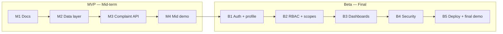

## 1. Purpose

Students at a campus report problems (hostel, library, cafeteria, IT, academics) through verbal requests, notice boards or scattered messages. Complaints get lost, students cannot see what happened to them, and the administration has no single place to review them.

The Campus Complaint Management System is built in two clear steps:

1. **MVP (mid-term):** a small, working **REST API to submit, view, edit, delete and resolve complaints (CRUD + status update)**, running locally.
2. **Beta (final):** turn the MVP into a secure multi-user product: accounts and login, roles (RBAC), security scopes, a profile dashboard, an admin dashboard, and deployment.

## 2. Problem statement

Students need one reliable place to submit a complaint and follow its progress. Administrators need one place to see all complaints, respond to them and mark them resolved. A student's complaints must stay private from other students, and only administrators may decide the outcome of a complaint.

## 3. Goals

| ID | Goal | Release |
|---|---|---|
| G-1 | Provide a REST API for complaint CRUD that follows standard REST conventions. | MVP |
| G-2 | Move each complaint through a clear status flow (`pending` → `in_progress` → `resolved` / `rejected`) with an admin response. | MVP |
| G-3 | Store complaints in a database so data survives restarts. | MVP |
| G-4 | Document the API automatically (OpenAPI at `/api/docs`). | MVP |
| G-5 | Each student has an account and sees only their own complaints. | Beta |
| G-6 | Control access with roles: `student` and `admin`. | Beta |
| G-7 | Enforce fine-grained permissions with security scopes on every endpoint. | Beta |
| G-8 | Give each user a profile dashboard and give admins a dashboard with system stats. | Beta |
| G-9 | Protect accounts and data (hashed passwords, token security, secrets in env vars). | Beta |
| G-10 | Deploy the system to a public URL. | Beta |

## 4. Target users

| User | Need | Release |
|---|---|---|
| Student / complainant | Submit, view, edit and delete complaints and see the admin's response. | MVP |
| Admin (campus staff) | See complaints, change their status and write a response. | MVP |
| Frontend developer | A clear, documented API to build the UI on. | MVP |
| Instructor / reviewer | An easy way to try the API (`/api/docs`) and check the code. | MVP |
| Registered student | Private complaint list behind a login, and a profile dashboard with name, password and complaint counts. | Beta |
| Admin (with account) | See all complaints, manage users and roles, and see usage stats on a dashboard. | Beta |

In the **MVP** there are no accounts: all complaint endpoints are open and there is one shared list. In the **Beta** every complaint belongs to a student.

## 5. Scope

### In scope — MVP (mid-term)
- Submit, list (with pagination and filters), view, edit (while pending), delete (while pending) complaints
- Update a complaint's status and admin response
- Input validation and clear error responses
- Health check endpoint
- Interactive API docs at `/api/docs`
- Runs locally with SQLite

### In scope — Beta (final)
- **Auth:** sign up, log in, log out, refresh session (JWT access token + refresh token)
- **User profile:** see my profile, change my name, change my password
- **Own complaints:** every complaint belongs to a student; students only see their own
- **RBAC:** `student` and `admin` roles; admin sees all complaints, changes status, manages roles
- **Security scopes/permissions:** the access token carries scopes and each endpoint requires a scope
- **Dashboards:** profile dashboard (my complaints by status) and admin dashboard (stats)
- **Security:** hashed passwords, secure cookies, security headers, secrets only in env vars
- **Deployment** to a public URL (Vercel + Supabase PostgreSQL)

### Out of scope for this semester
- Automated test suite and CI/CD pipeline
- File or image attachments on complaints
- Email/SMS notifications
- Anonymous complaints
- Routing complaints to several departments, assigning complaints to staff
- Comments or chat threads on a complaint
- Email verification, password reset, social login, changing email
- Banning users, login attempt limits

## 6. Features and priority (MoSCoW)

Priorities are per release: a Beta "Must" is required for the final, not for the mid-term.

| ID | Feature | Release | Priority |
|---|---|---|---|
| F-1 | Submit complaint | MVP | Must |
| F-2 | List complaints | MVP | Must |
| F-3 | Get complaint by ID | MVP | Must |
| F-4 | Edit complaint (only while `pending`) | MVP | Must |
| F-5 | Delete complaint (only while `pending`) | MVP | Must |
| F-6 | Update status and admin response | MVP | Must |
| F-7 | Validation and error responses | MVP | Must |
| F-8 | Health check | MVP | Must |
| F-9 | Pagination and filter by status / category | MVP | Should |
| F-10 | Simple page that uses the API | MVP | Could |
| F-11 | Sign up, log in, log out, refresh session | Beta | Must |
| F-12 | Complaints owned by a student, private | Beta | Must |
| F-13 | Roles `student` / `admin` with permission checks | Beta | Must |
| F-14 | Security scopes in the access token, enforced per endpoint | Beta | Must |
| F-15 | User profile: view profile, change name, change password | Beta | Should |
| F-16 | Profile dashboard (my complaints by status) | Beta | Should |
| F-17 | Admin: list users, change role | Beta | Should |
| F-18 | Admin dashboard stats | Beta | Should |
| F-19 | Security hardening (hashing, cookies, headers) | Beta | Must |
| F-20 | Deployment to a public URL | Beta | Must |
| F-21 | Pages for login, my complaints and dashboards | Beta | Could |

## 7. User stories

### MVP

| ID | Story | Feature |
|---|---|---|
| US-01 | As a student, I want to submit a complaint with a title, description and category, so the campus knows about my problem. | F-1 |
| US-02 | As a user, I want to see a list of complaints, so I can find one quickly. | F-2, F-9 |
| US-03 | As an admin, I want to filter complaints by status and category, so I can focus on what needs attention. | F-9 |
| US-04 | As a student, I want to open one complaint, so I can read its status and the admin response. | F-3 |
| US-05 | As a student, I want to edit a complaint that is still pending, so I can fix mistakes. | F-4 |
| US-06 | As a student, I want to delete a complaint that is still pending, so I can withdraw it. | F-5 |
| US-07 | As an admin, I want to change a complaint's status and write a response, so the student knows what happened. | F-6 |
| US-08 | As a client developer, I want clear error messages, so I know what went wrong. | F-7 |
| US-09 | As a maintainer, I want a health endpoint, so I can check the system is running. | F-8 |

### Beta

| ID | Story | Feature |
|---|---|---|
| US-10 | As a visitor, I want to sign up with my email and a password, so I get my own account. | F-11 |
| US-11 | As a user, I want to log in and log out, so only I can use my account. | F-11 |
| US-12 | As a student, I want to see only my own complaints, so my data stays private. | F-12 |
| US-13 | As an admin, I want to see all complaints and delete inappropriate ones, so I can manage the whole campus. | F-13 |
| US-14 | As a student, I want only admins to be able to change my complaint's status, so the outcome can be trusted. | F-13, F-14 |
| US-15 | As a user, I want to view my profile and change my name and password, so I can keep my account up to date and secure. | F-15 |
| US-16 | As a student, I want a profile dashboard with the number of my complaints by status, so I can track progress at a glance. | F-16 |
| US-17 | As an admin, I want to list users and change a user's role, so I can decide who is an admin. | F-17 |
| US-18 | As an admin, I want a dashboard with stats (complaints by status and category, users, recent activity), so I can see how the system is used. | F-18 |
| US-19 | As a user, I want my password stored safely, so my account is hard to break into. | F-19 |
| US-20 | As a user, I want to open the system from a public URL, so I do not need to run it myself. | F-20 |

## 8. Success metrics

### MVP
- All six complaint endpoints work from `/api/docs` on a local machine.
- A complaint can be submitted, edited and resolved by an admin in one demo run.
- Invalid input returns a clear error message and never crashes the server.
- Data is still there after restarting the server.

### Beta
- A student can never read, change or delete another student's complaint.
- Only an admin can change a complaint's status; a student attempting it gets `403`.
- Every endpoint enforces the permission matrix in the [SRS, section 3.9](02-srs.md#39-permission-matrix--beta).
- Passwords are never stored or returned in plain text, and no secret is committed to Git.
- The public URL serves the API and `/api/docs` during the final demo.

## 9. Assumptions and constraints

- MVP runs locally with SQLite. Beta is deployed to Vercel with Supabase PostgreSQL (Vercel functions are serverless, so data must live in an external database).
- Backend: Python 3.10+, FastAPI, SQLModel. Frontend (optional): Vite + React + TypeScript.
- The first admin is promoted manually (role set in the Supabase table editor); after that admins manage roles through the API.
- MVP data is demo data; it does not need to be kept when the Beta adds student ownership.
- Students are identified by their email; there is no check against a university student database.

## 10. Milestones

### MVP — Mid-term

| Milestone | Deliverable |
|---|---|
| M1 — Docs | [PRD](01-prd.md), [SRS](02-srs.md) and [TDD](03-tdd.md) (covering MVP and Beta) merged into `docs/` |
| M2 — Data layer | Complaint model and database connection |
| M3 — API | Six complaint endpoints with validation and status rules |
| M4 — Mid demo | Running locally, tagged `v0.1.0` (MVP) |

### Beta — Final

| Milestone | Deliverable |
|---|---|
| B1 — Auth + profile | Sign up, login, logout, refresh, profile (change name and password); complaints owned by a student; Alembic migrations in place |
| B2 — RBAC + scopes | `student` and `admin` roles, scopes in the token, permission checks on every endpoint, admin user endpoints |
| B3 — Dashboards | Profile dashboard and admin dashboard stats |
| B4 — Security | Password hashing, secure cookies, security headers, secret review |
| B5 — Deploy + final demo | Beta live on a public URL, tagged `v0.2.0` (Beta) |

## 11. Release dependencies

- The Beta is built on top of the MVP: the same `/api/v1/complaints` endpoints stay, but in the Beta they require login and are limited by role and scope.
- Database migrations (Alembic) are introduced at the start of the Beta so the schema can grow from one table to three without manual SQL.


---

# Part II — Software Requirements Specification (SRS)

# Software Requirements Specification (SRS) — Campus Complaint Management System

| Field | Value |
|---|---|
| Product | Campus Complaint Management System (CCMS) |
| Version | MVP + Beta |
| Releases | MVP — Mid-term, Beta — Final |
| Status | Draft |
| Related docs | [Product Requirements Document (PRD)](01-prd.md), [Technical Design Document (TDD)](03-tdd.md) |

Every requirement has a **Release** column: **MVP** is built for the mid-term, **Beta** is added for the final.

**Documents in this set**

| Short form | Full form | Purpose | File |
|---|---|---|---|
| PRD | Product Requirements Document | What we build and why | [01-prd.md](01-prd.md) |
| SRS | Software Requirements Specification | Exact requirements, permissions and acceptance criteria (this document) | [02-srs.md](02-srs.md) |
| TDD | Technical Design Document | How we build it: architecture, data model, API | [03-tdd.md](03-tdd.md) |

## 1. Introduction

### 1.1 Purpose
This document lists the requirements for the Campus Complaint Management System: the MVP (complaint CRUD and status REST API, running locally) and the Beta (accounts, roles, scopes, dashboards, security and deployment).

### 1.2 Scope
- **MVP:** a client can submit, list, view, edit, delete and resolve complaints over HTTP. There are no accounts; all complaints are in one shared list.
- **Beta:** students sign up and log in, see only their own complaints, and admins handle all complaints, manage roles and see stats.
- Out of scope: see [PRD, section 5](01-prd.md#5-scope).

### 1.3 Definitions

| Term | Meaning |
|---|---|
| CRUD | Create, Read, Update, Delete |
| REST | API style where resources (like `complaints`) are accessed with HTTP methods (GET, POST, PATCH, DELETE) |
| Complaint | A problem report with a title, description, category, status and optional admin response |
| Category | One of `academic`, `hostel`, `library`, `cafeteria`, `transport`, `it_network`, `other` |
| Status | One of `pending`, `in_progress`, `resolved`, `rejected` |
| Admin response | Text written by an admin explaining the decision or action taken |
| RBAC | Role-Based Access Control: what a caller can do depends on their role |
| Scope | (Beta) A named permission, for example `complaint:status`; roles are mapped to scopes |
| JWT | JSON Web Token: a signed token that proves who the caller is |
| Access token | (Beta) Short-lived JWT sent in the `Authorization: Bearer` header |
| Refresh token | (Beta) Long-lived random token in an HttpOnly cookie, used to get a new access token |
| Client | Anything that calls the API: a web page, `/api/docs`, curl, Postman |
| OpenAPI | Standard API description; FastAPI generates it and shows it at `/api/docs` |

## 2. Overall description

### 2.1 System context

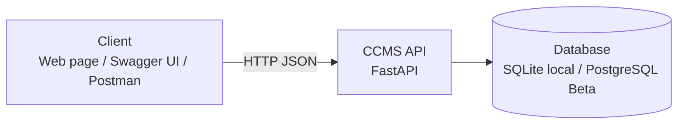

### 2.2 Users and roles

| Role | Release | Description |
|---|---|---|
| Anonymous client | MVP | Anyone who can reach the API; full access to the shared complaint list |
| Guest | Beta | Not logged in; can only sign up, log in, check health and read the API docs |
| Student | Beta | Logged in with role `student`; submits and manages own complaints, manages own profile |
| Admin | Beta | Logged in with role `admin`; sees all complaints, changes status and responds, deletes complaints, lists users, changes roles, sees stats |

`student` and `admin` are **global** roles stored on the user. Each role is mapped to a set of **scopes** (see [TDD, section 10.3](03-tdd.md#103-security-scopes-and-permission-dependencies)).

### 2.3 Use cases

**MVP**

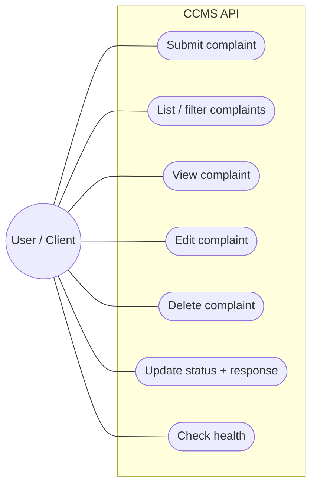

**Beta**

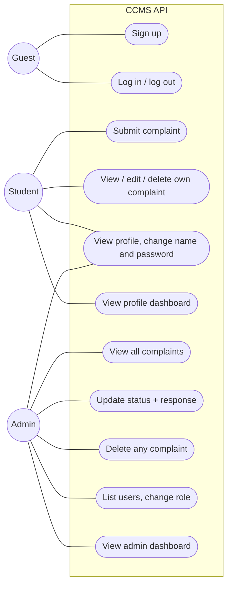

### 2.4 Constraints
- C-1: MVP runs locally with SQLite; no external service is needed.
- C-2: Beta runs on Vercel serverless functions (no local disk that survives between requests).
- C-3: Backend in Python 3.10+ with FastAPI.
- C-4: All API routes start with `/api`, because `vercel.json` sends `/api/*` to the backend.
- C-5: Requests and responses use JSON.
- C-6: Production database is Supabase PostgreSQL; local development uses SQLite.
- C-7: (Beta) Login is implemented in our own API (no third-party login providers).

### 2.5 Assumptions
- A-1: (Beta) A hosted database is available to the Vercel project through an environment variable.
- A-2: The system is used for demos and class work, so traffic is low.
- A-3: (Beta) The first admin is promoted manually in the Supabase table editor.
- A-4: (Beta) MVP complaints are demo data and may be removed when complaints get a student owner.
- A-5: (Beta) A student is identified by their email address; no student-ID verification is done.

## 3. Functional requirements

### 3.1 Complaints — MVP

| ID | Requirement | Release | Story |
|---|---|---|---|
| FR-01 | The system shall create a complaint from a JSON body with `title`, `description` and `category` (all required). New complaints have status `pending`. | MVP | US-01 |
| FR-02 | The system shall return the list of complaints, newest first. | MVP | US-02 |
| FR-03 | The list shall support `offset` (default 0) and `limit` (default 20, max 100) query parameters. | MVP | US-02 |
| FR-04 | The list shall support optional `status` and `category` filters that can be combined. | MVP | US-03 |
| FR-05 | The system shall return one complaint by its ID. | MVP | US-04 |
| FR-06 | The system shall update `title`, `description` or `category` of a complaint only while its status is `pending`; otherwise it returns `409`. Fields not sent stay unchanged. | MVP | US-05 |
| FR-07 | The system shall delete a complaint only while its status is `pending`; otherwise it returns `409`. | MVP | US-06 |
| FR-08 | The system shall change a complaint's `status` following the state diagram (section 3.8) and store an optional `admin_response`. An invalid transition returns `409`. `admin_response` is required when the new status is `rejected`. | MVP | US-07 |
| FR-09 | The system shall set `created_at` when a complaint is created and update `updated_at` on every change. | MVP | US-01, US-05, US-07 |
| FR-10 | The system shall reject invalid input with status `422` and a message saying which field is wrong. | MVP | US-08 |
| FR-11 | The system shall return `404` when a complaint ID does not exist. | MVP | US-08 |
| FR-12 | The system shall expose `GET /api/health` returning `{"status": "ok"}`. | MVP | US-09 |
| FR-13 | The system shall publish interactive API docs at `/api/docs`. | MVP | US-08 |

### 3.2 Authentication and profile — Beta

| ID | Requirement | Release | Story |
|---|---|---|---|
| FR-14 | The system shall let a guest sign up with `email`, `name` and `password`. Email is unique (case-insensitive); a duplicate returns `409`. New users get role `student`. | Beta | US-10 |
| FR-15 | The system shall log a user in with email and password, returning an access token in the body and setting a refresh token cookie. Wrong email or wrong password returns `401` with the same message for both. | Beta | US-11 |
| FR-16 | The system shall issue a new access token when called with a valid refresh token cookie, and replace (rotate) the refresh token. | Beta | US-11 |
| FR-17 | The system shall log a user out by revoking the refresh token and clearing the cookie. | Beta | US-11 |
| FR-18 | The system shall return the logged-in user's profile (`id`, `email`, `name`, `role`, `created_at`). The password hash is never returned. | Beta | US-15 |
| FR-19 | A user shall be able to change their own `name`. Email and role cannot be changed through the profile. | Beta | US-15 |
| FR-20 | A user shall be able to change their password by sending the current and the new password. A wrong current password returns `400`. On success all the user's refresh tokens are revoked and they log in again. | Beta | US-15 |
| FR-21 | In the Beta, every complaint, profile, user and admin endpoint shall require a valid access token; otherwise it returns `401`. | Beta | US-12 |

### 3.3 Own complaints — Beta

| ID | Requirement | Release | Story |
|---|---|---|---|
| FR-22 | A complaint created through `/api/v1/complaints` shall belong to the logged-in student. A student's list returns only their own complaints. | Beta | US-12 |
| FR-23 | Reading, editing or deleting another student's complaint shall return `404`, so the complaint's existence is not revealed. | Beta | US-12 |

### 3.4 Roles (RBAC) and admin — Beta

| ID | Requirement | Release | Story |
|---|---|---|---|
| FR-24 | An admin shall be able to list and view all complaints (with the existing filters and pagination). | Beta | US-13 |
| FR-25 | Only an admin shall be able to change a complaint's status and admin response. A student calling that endpoint gets `403`. | Beta | US-14 |
| FR-26 | An admin shall be able to delete any complaint, in any status. | Beta | US-13 |
| FR-27 | An admin shall be able to list all users (paginated). | Beta | US-17 |
| FR-28 | An admin shall be able to change another user's role (`student` or `admin`). An admin cannot change their own role (`400`), so the system always keeps at least one admin. | Beta | US-17 |
| FR-29 | A non-admin calling an admin-only endpoint shall get `403`. | Beta | US-14, US-17, US-18 |

### 3.5 Dashboards — Beta

| ID | Requirement | Release | Story |
|---|---|---|---|
| FR-30 | The system shall provide a profile dashboard for the logged-in user: their profile plus their number of complaints in total and per status. | Beta | US-16 |
| FR-31 | An admin shall be able to view dashboard stats: total complaints, complaints per status, complaints per category, complaints created in the last 7 days, total users, admins, and new users in the last 7 days. | Beta | US-18 |

### 3.6 Security scopes and deployment — Beta

| ID | Requirement | Release | Story |
|---|---|---|---|
| FR-32 | The access token shall carry the caller's scopes (derived from the role), and every protected endpoint shall require a specific scope. A missing scope returns `403`. | Beta | US-14 |
| FR-33 | The system shall be reachable at a public URL, with `/api/docs` available. | Beta | US-20 |

### 3.7 Validation rules

| Field | Rule | Release |
|---|---|---|
| `title` | Required on create, string, 5–100 characters after trimming spaces | MVP |
| `description` | Required on create, string, 10–2000 characters after trimming spaces | MVP |
| `category` | Required on create, one of `academic`, `hostel`, `library`, `cafeteria`, `transport`, `it_network`, `other` | MVP |
| `status` | One of `pending`, `in_progress`, `resolved`, `rejected` | MVP |
| `admin_response` | Optional, max 1000 characters; required when status becomes `rejected` | MVP |
| `offset` | Integer ≥ 0 | MVP |
| `limit` | Integer 1–100 | MVP |
| `email` | Valid email, max 254 characters, stored lowercase | Beta |
| `name` (user) | 2–100 characters | Beta |
| `password` | 8–128 characters, at least one letter and one digit | Beta |
| `role` | `student` or `admin` | Beta |

### 3.8 Complaint states

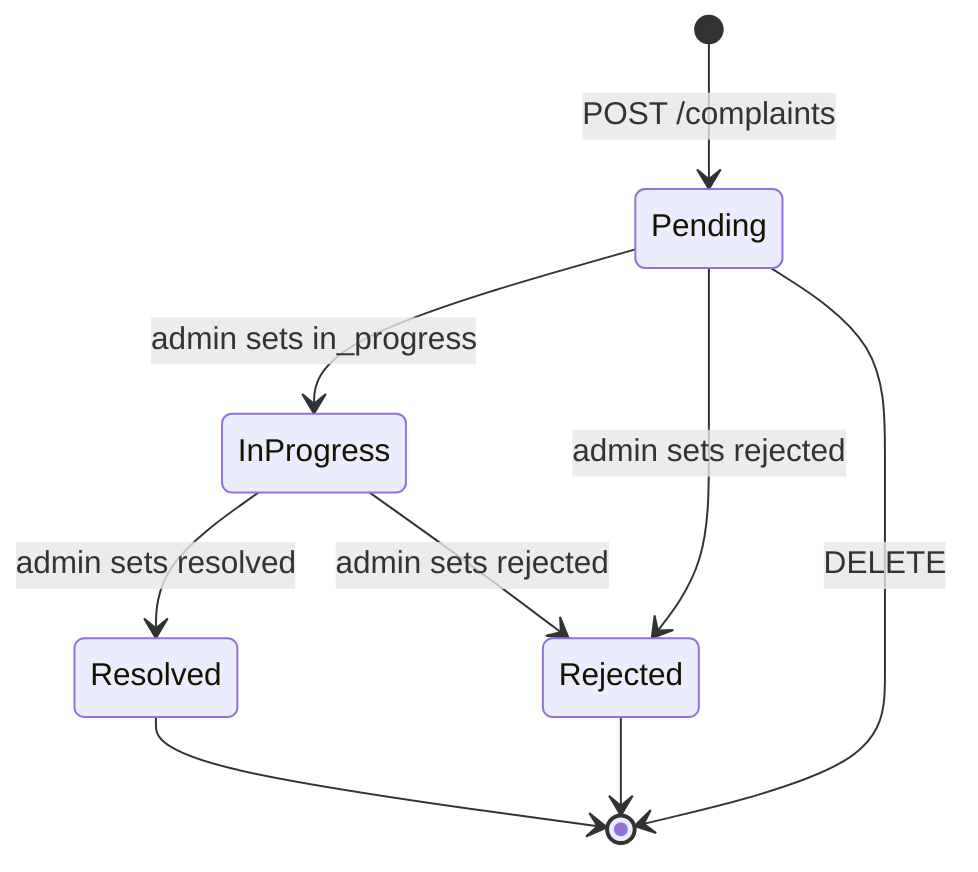

A new complaint always starts as `pending`. `resolved` and `rejected` are final: they cannot change again. Edit and delete by a student are allowed only in `pending`. (In the Beta an admin can delete in any status, see FR-26.)

### 3.9 Permission matrix — Beta

| Action | Guest | Student | Admin |
|---|---|---|---|
| Sign up, log in, refresh | Yes | — | — |
| Log out, view own profile, change own name and password, profile dashboard | No | Yes | Yes |
| Submit a complaint | No | Yes | No (`403`) |
| List complaints | No | Own only | All |
| View one complaint | No | Own only (others `404`) | Any |
| Edit a complaint (only while `pending`) | No | Own only | No (`403`) |
| Delete a complaint | No | Own, only while `pending` | Any |
| Change status / write admin response | No | No (`403`) | Yes |
| List users, change a user's role | No | No (`403`) | Yes (not own role) |
| View admin dashboard stats | No | No (`403`) | Yes |

### 3.10 Status codes

| Case | Code | Release |
|---|---|---|
| Resource created | `201 Created` | MVP |
| Read or update succeeded | `200 OK` | MVP |
| Deleted / logged out / password changed | `204 No Content` | MVP |
| Validation failed | `422 Unprocessable Content` | MVP |
| Resource not found, or caller may not know it exists | `404 Not Found` | MVP |
| Action not allowed in the current state (edit/delete after `pending`, invalid status change) | `409 Conflict` | MVP |
| Unexpected server error | `500 Internal Server Error` | MVP |
| Bad request (e.g. admin changing own role, wrong current password) | `400 Bad Request` | Beta |
| Missing, invalid or expired token; wrong login | `401 Unauthorized` | Beta |
| Logged in but role or scope not allowed | `403 Forbidden` | Beta |
| Duplicate (email already registered) | `409 Conflict` | Beta |

## 4. Non-functional requirements

| ID | Category | Requirement | Release |
|---|---|---|---|
| NFR-01 | Performance | 95% of complaint requests answer in under 500 ms on a normal laptop or the deployed system (excluding a cold start). | MVP |
| NFR-02 | Persistence | Data is stored in a database and is not lost when the server restarts. | MVP |
| NFR-03 | Usability (setup) | A new developer can run the API locally by following the README, with no external service. | MVP |
| NFR-04 | Security | Database credentials and secrets are stored only in environment variables, never in Git. | MVP |
| NFR-05 | Security | Database queries use the ORM with parameters, never string-built SQL. | MVP |
| NFR-06 | Security | Error responses do not expose stack traces or database details. | MVP |
| NFR-07 | Maintainability | Code is split into layers: routes, schemas, models, services, database. | MVP |
| NFR-08 | Usability (API) | Every endpoint is listed in `/api/docs` with request and response schemas. | MVP |
| NFR-09 | Deployability | The Beta runs on Vercel; a push to `main` updates production. | Beta |
| NFR-10 | Security | All traffic uses HTTPS (provided by Vercel). | Beta |
| NFR-11 | Security | Passwords are hashed with Argon2; plain passwords are never stored, logged or returned. | Beta |
| NFR-12 | Security | Access tokens are JWTs signed with a secret of at least 32 bytes from an env var, valid for 15 minutes. | Beta |
| NFR-13 | Security | Refresh tokens are random, valid for 7 days, stored only as a hash, and replaced on every refresh. | Beta |
| NFR-14 | Security | The refresh token cookie is `HttpOnly`, `Secure`, `SameSite=Strict` and limited to path `/api/v1/auth`. | Beta |
| NFR-15 | Security | Frontend and API share one origin, so CORS stays disabled (no cross-origin access). | Beta |
| NFR-16 | Security | Responses include security headers: `X-Content-Type-Options`, `X-Frame-Options`, `Referrer-Policy`, `Strict-Transport-Security`. | Beta |
| NFR-17 | Security | Every permission and scope check runs on the server for every request; a frontend hiding a button is never the only protection. | Beta |
| NFR-18 | Security | Least privilege: each role gets only the scopes it needs. | Beta |
| NFR-19 | Performance | Sign up and login answer in under 1 s (password hashing is slow on purpose). | Beta |
| NFR-20 | Maintainability | Database schema changes are made through Alembic migrations, not by hand. | Beta |

## 5. Acceptance criteria

### MVP

**AC-01 Submit complaint (FR-01, FR-09)**
- Given a valid body `{"title": "Broken fan in room 204", "description": "The ceiling fan has not worked for a week.", "category": "hostel"}`
- When the client sends `POST /api/v1/complaints`
- Then the response is `201` with an `id`, `status: "pending"`, and `created_at` set.

**AC-02 Invalid complaint (FR-10)**
- Given a body with a title of 2 characters, or a category `"gym"`
- When the client sends `POST /api/v1/complaints`
- Then the response is `422` and mentions the wrong field.

**AC-03 List complaints (FR-02, FR-03)**
- Given 25 complaints exist
- When the client sends `GET /api/v1/complaints?limit=10&offset=0`
- Then the response is `200` with 10 complaints, newest first.

**AC-04 Filter complaints (FR-04)**
- Given 3 `pending` and 2 `resolved` complaints, 1 of the resolved ones in category `library`
- When the client sends `GET /api/v1/complaints?status=resolved&category=library`
- Then the response contains exactly that 1 complaint.

**AC-05 Get complaint (FR-05, FR-11)**
- Given complaint `5` exists
- When the client sends `GET /api/v1/complaints/5`, the response is `200` with that complaint.
- When the client sends `GET /api/v1/complaints/9999`, the response is `404`.

**AC-06 Edit pending complaint (FR-06, FR-09)**
- Given complaint `5` is `pending`
- When the client sends `PATCH /api/v1/complaints/5` with `{"title": "Broken fan in room 205"}`
- Then the response is `200`, the title is changed, the description is unchanged, and `updated_at` is newer.

**AC-07 Edit non-pending complaint (FR-06)**
- Given complaint `6` is `in_progress`
- When the client sends `PATCH /api/v1/complaints/6` with a new description
- Then the response is `409` and the complaint is unchanged.

**AC-08 Update status (FR-08)**
- Given complaint `5` is `pending`
- When the client sends `PATCH /api/v1/complaints/5/status` with `{"status": "in_progress"}`, the response is `200` with the new status.
- When the client then sends `{"status": "resolved", "admin_response": "Fan replaced."}`, the response is `200` with both values.

**AC-09 Invalid status change (FR-08)**
- Given complaint `7` is `resolved`
- When the client sends `PATCH /api/v1/complaints/7/status` with `{"status": "pending"}`, the response is `409`.
- When a `pending` complaint is set to `rejected` without an `admin_response`, the response is `422`.

**AC-10 Delete complaint (FR-07)**
- Given complaint `5` is `pending`
- When the client sends `DELETE /api/v1/complaints/5`
- Then the response is `204`, and a following `GET /api/v1/complaints/5` returns `404`.
- Given complaint `6` is `in_progress`, `DELETE /api/v1/complaints/6` returns `409`.

**AC-11 Health (FR-12)**
- When the client sends `GET /api/health`
- Then the response is `200` with `{"status": "ok"}`.

### Beta

**AC-12 Sign up (FR-14)**
- Given no account exists for `a@x.com`
- When a guest signs up with that email, the response is `201` with role `student` and no password field.
- When anyone signs up again with `A@x.com`, the response is `409`.

**AC-13 Log in (FR-15)**
- Given user `a@x.com` exists
- When they log in with the right password, the response is `200` with an `access_token`, and a `refresh_token` cookie is set.
- When they log in with a wrong password, the response is `401`.

**AC-14 Token required (FR-21)**
- When a client calls `GET /api/v1/complaints` without a token, or with an expired one
- Then the response is `401`.

**AC-15 Private complaints (FR-22, FR-23)**
- Given student A owns complaint `5`
- When student B sends `GET`, `PATCH` or `DELETE /api/v1/complaints/5`
- Then the response is `404`, and A's complaint is unchanged.
- When B lists complaints, complaint `5` is not in the list.

**AC-16 Student cannot change status (FR-25, FR-32)**
- Given a logged-in student
- When they send `PATCH /api/v1/complaints/5/status`
- Then the response is `403`.

**AC-17 Admin sees all and responds (FR-24, FR-25)**
- Given complaints from several students
- When an admin lists complaints, they see all of them.
- When the admin sets status `resolved` with a response, the response is `200`, and the owning student sees the new status and response.

**AC-18 Admin only users (FR-27, FR-29)**
- When a `student` calls `GET /api/v1/admin/users`, the response is `403`.
- When an `admin` calls it, the response is `200` with the user list.

**AC-19 Change role (FR-28)**
- When an admin sets user B's role to `admin`, the response is `200` and B can now call admin endpoints.
- When an admin tries to change their own role, the response is `400`.

**AC-20 Profile dashboard (FR-30)**
- Given a student with 4 complaints (2 `pending`, 1 `resolved`, 1 `rejected`)
- When they send `GET /api/v1/users/me/dashboard`
- Then the response is `200` with `total = 4`, `pending = 2`, `in_progress = 0`, `resolved = 1`, `rejected = 1`.

**AC-21 Admin dashboard stats (FR-31)**
- Given 10 users (2 admins) and 40 complaints (15 `resolved`)
- When an admin sends `GET /api/v1/admin/stats`
- Then the response is `200` with `users.total = 10`, `users.admins = 2`, `complaints.total = 40` and `complaints.by_status.resolved = 15`.
- When a `student` sends it, the response is `403`.

**AC-22 Edit profile and change password (FR-19, FR-20)**
- When a user sends `PATCH /api/v1/users/me` with `{"name": "Sakib A."}`, the response is `200` with the new name; `email` and `role` are unchanged.
- When they send the wrong `current_password`, the response is `400`.
- When they send the right one and a valid `new_password`, the response is `204`, their refresh token no longer works, and they can log in only with the new password.

**AC-23 Admin deletes any complaint (FR-26)**
- Given complaint `6` is `in_progress` and owned by a student
- When an admin sends `DELETE /api/v1/complaints/6`, the response is `204`.
- When the owning student sends the same request, the response is `409`.

**AC-24 Scope enforced (FR-32)**
- Given an access token that does not contain the scope `complaint:status`
- When it is used on `PATCH /api/v1/complaints/{id}/status`
- Then the response is `403`.

## 6. Traceability

| Story | Requirements | Endpoint (see [TDD, section 6](03-tdd.md#6-rest-api-design)) | Release |
|---|---|---|---|
| US-01 | FR-01, FR-09 | `POST /api/v1/complaints` | MVP |
| US-02 | FR-02, FR-03 | `GET /api/v1/complaints` | MVP |
| US-03 | FR-04 | `GET /api/v1/complaints?status=&category=` | MVP |
| US-04 | FR-05 | `GET /api/v1/complaints/{id}` | MVP |
| US-05 | FR-06, FR-09 | `PATCH /api/v1/complaints/{id}` | MVP |
| US-06 | FR-07 | `DELETE /api/v1/complaints/{id}` | MVP |
| US-07 | FR-08, FR-09 | `PATCH /api/v1/complaints/{id}/status` | MVP |
| US-08 | FR-10, FR-11, FR-13 | All, `/api/docs` | MVP |
| US-09 | FR-12 | `GET /api/health` | MVP |
| US-10 | FR-14 | `POST /api/v1/auth/signup` | Beta |
| US-11 | FR-15, FR-16, FR-17 | `/api/v1/auth/login`, `/refresh`, `/logout` | Beta |
| US-12 | FR-21, FR-22, FR-23 | `/api/v1/complaints` (all) | Beta |
| US-13 | FR-24, FR-26 | `GET /api/v1/complaints`, `DELETE /api/v1/complaints/{id}` | Beta |
| US-14 | FR-25, FR-29, FR-32 | `PATCH /api/v1/complaints/{id}/status` | Beta |
| US-15 | FR-18, FR-19, FR-20 | `GET` / `PATCH /api/v1/users/me`, `POST /api/v1/users/me/password` | Beta |
| US-16 | FR-30 | `GET /api/v1/users/me/dashboard` | Beta |
| US-17 | FR-27, FR-28, FR-29 | `GET /api/v1/admin/users`, `PATCH /api/v1/admin/users/{id}/role` | Beta |
| US-18 | FR-29, FR-31 | `GET /api/v1/admin/stats` | Beta |
| US-19 | NFR-11, NFR-12, NFR-13, NFR-14 | `POST /api/v1/auth/login`, `POST /api/v1/auth/signup` | Beta |
| US-20 | FR-33, NFR-09, NFR-10 | Public URL, `/api/docs`, `GET /api/health` | Beta |


---

# Part III — Technical Design Document (TDD)

# Technical Design Document (TDD) — Campus Complaint Management System

| Field | Value |
|---|---|
| Product | Campus Complaint Management System (CCMS) |
| Version | MVP + Beta |
| Releases | MVP — Mid-term, Beta — Final |
| Status | Draft |
| Related docs | [Product Requirements Document (PRD)](01-prd.md), [Software Requirements Specification (SRS)](02-srs.md) |

Sections and tables are marked **MVP** or **Beta**. Build the MVP parts for the mid-term; the Beta parts extend them for the final.

**Documents in this set**

| Short form | Full form | Purpose | File |
|---|---|---|---|
| PRD | Product Requirements Document | What we build and why | [01-prd.md](01-prd.md) |
| SRS | Software Requirements Specification | Exact requirements, permissions and acceptance criteria | [02-srs.md](02-srs.md) |
| TDD | Technical Design Document | How we build it: architecture, data model, API (this document) | [03-tdd.md](03-tdd.md) |

## 1. Overview

- **MVP:** a FastAPI REST API for complaint CRUD and status updates, stored in a SQL database through SQLModel (SQLite locally). The demo is done from the interactive docs at `/api/docs`.
- **Beta:** the same app gains users and login (JWT), global roles (`student` / `admin`), security scopes, profile and admin dashboards, and security hardening. Schema changes are managed with Alembic. The app is deployed to Vercel with Supabase PostgreSQL.

## 2. Tech stack

| Layer | Choice | Why | Release |
|---|---|---|---|
| API | FastAPI | Validation, OpenAPI docs and type hints out of the box | MVP |
| ORM / models | SQLModel | One class works as both the Pydantic schema and the database table | MVP |
| Database (local) | SQLite | No setup needed | MVP |
| Frontend (optional) | Vite + React + TypeScript | Simple page(s) that call the API | MVP (Could), Beta (Could) |
| Database (production) | PostgreSQL on Supabase | Free tier, managed Postgres with a web dashboard and connection pooler for serverless | Beta |
| DB driver | `psycopg[binary]` (psycopg 3) | Standard Postgres driver for SQLAlchemy/SQLModel | Beta |
| Hosting | Vercel | Frontend and backend in one project (`vercel.json`), auto deploy from GitHub | Beta |
| Migrations | Alembic | Versioned schema changes as the model grows from 1 to 3 tables | Beta |
| JWT | PyJWT | Sign and verify access tokens | Beta |
| Password hashing | `pwdlib[argon2]` | Argon2 hashing, recommended in the FastAPI docs | Beta |

## 3. Architecture

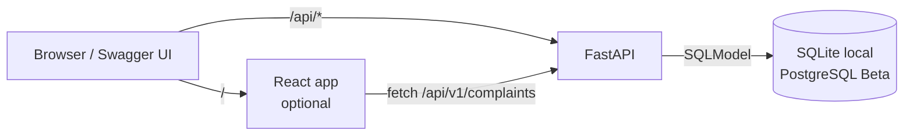

All backend routes start with `/api` (on Vercel, `vercel.json` sends `/api/*` to the backend). For the same reason the API docs are served at `/api/docs` (not FastAPI's default `/docs`):

```python
app = FastAPI(title="CCMS API", docs_url="/api/docs", openapi_url="/api/openapi.json", redoc_url=None)
```

### 3.1 Request flow — MVP

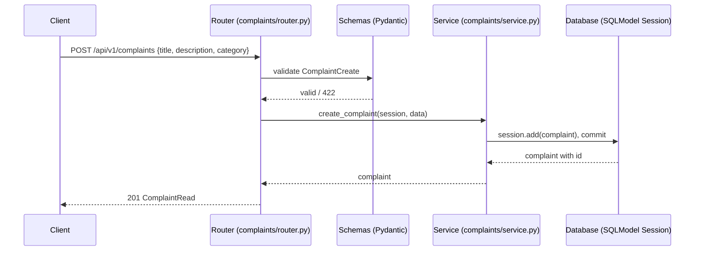

### 3.2 Login and refresh flow — Beta

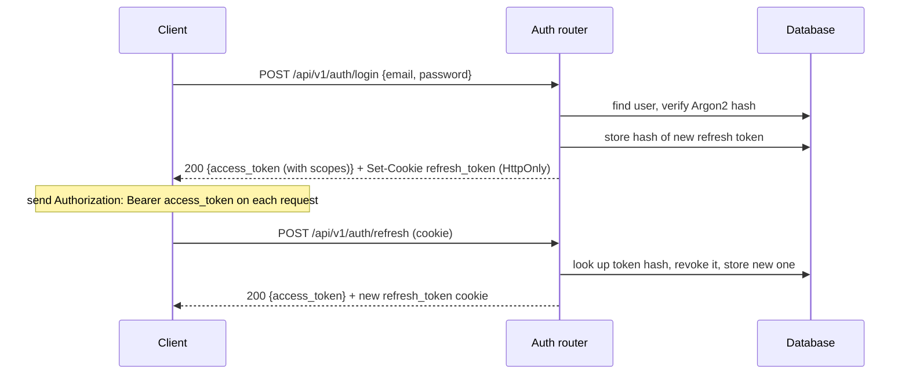

## 4. Project structure

```
backend/
  main.py              # creates the app, includes each feature's router, health check, catch-all 500 handler
  app/
    config.py          # settings from env vars (DATABASE_URL; Beta: JWT secret, token lifetimes)
    database.py        # engine, get_session(), SessionDep, create_db_and_tables()
    security.py        # (Beta) password hashing, JWT create/verify, refresh tokens, scope table
    complaints/        # one folder per feature (domain), everything for complaints together
      router.py        # /api/v1/complaints endpoints (APIRouter)
      schemas.py       # ComplaintCreate / ComplaintUpdate / StatusUpdate / ComplaintRead
      models.py        # Complaint table, Category and Status enums
      service.py       # business rules (status transitions, pending-only edit) and database queries
      dependencies.py  # valid_complaint: resolves {complaint_id} to a Complaint or answers 404
    auth/              # (Beta) router, schemas, models (AppUser, RefreshToken), service, dependencies (get_current_user, require_scope)
    users/             # (Beta) /api/v1/users/me (profile, change name, change password, dashboard)
    admin/             # (Beta) /api/v1/admin/* (users, role change, stats)
  alembic/             # (Beta) migration scripts
  alembic.ini          # (Beta)
  requirements.txt
frontend/              # (optional) Vite + React + TypeScript
  src/
    pages/             # (Beta) Login, Signup, MyComplaints, Profile, AdminDashboard
    services/          # api.ts (every backend call)
docs/
  01-prd.md
  02-srs.md
  03-tdd.md
```

The backend is organised by feature (domain): each folder holds its own router, schemas, models, service and dependencies. A **router** parses the request and calls the service; **dependencies** (`Depends`) do reusable checks, such as loading a complaint or answering `404`, and later the permission checks; the **service** holds the business rules and database queries through the SQLModel session and knows nothing about HTTP. `main.py` only wires the routers together and adds the catch-all `500` handler.

## 5. Data model

### 5.1 `complaint` table — MVP

| Column | Type | Rules |
|---|---|---|
| `id` | integer | Primary key, auto increment |
| `title` | varchar(100) | Not null |
| `description` | varchar(2000) | Not null |
| `category` | varchar(20) | Not null, one of the categories in SRS 1.3 |
| `status` | varchar(15) | Not null, default `pending` |
| `admin_response` | varchar(1000) | Nullable |
| `created_at` | timestamp (UTC) | Not null, set on insert |
| `updated_at` | timestamp (UTC) | Not null, set on insert and every update |

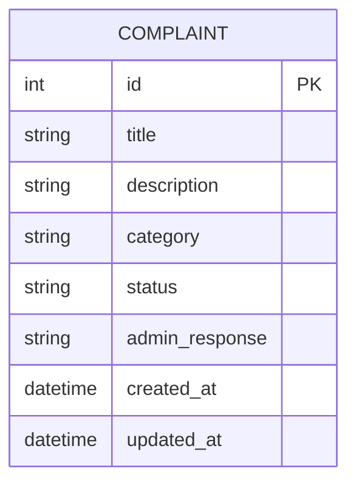

### 5.2 Full data model — Beta

`user` is a reserved word in PostgreSQL, so the table is named `app_user`.

**`app_user`**

| Column | Type | Rules |
|---|---|---|
| `id` | integer | Primary key |
| `email` | varchar(254) | Unique, stored lowercase |
| `name` | varchar(100) | Not null |
| `password_hash` | varchar | Argon2 hash, never returned by the API |
| `role` | varchar(10) | `student` or `admin`, default `student` |
| `created_at`, `updated_at` | timestamp (UTC) | Not null |

**`refresh_token`**

| Column | Type | Rules |
|---|---|---|
| `id` | integer | Primary key |
| `user_id` | integer | FK → `app_user.id`, on delete cascade |
| `token_hash` | char(64) | SHA-256 of the token, unique |
| `expires_at` | timestamp (UTC) | Not null (now + 7 days) |
| `revoked_at` | timestamp (UTC) | Nullable |
| `created_at` | timestamp (UTC) | Not null |

**`complaint` (new column in Beta)**

| Column | Type | Rules |
|---|---|---|
| `student_id` | integer | FK → `app_user.id`, not null: the student who submitted the complaint |

Indexes: `complaint(student_id)`, `complaint(status)`, `complaint(category)`, `refresh_token(user_id)`.

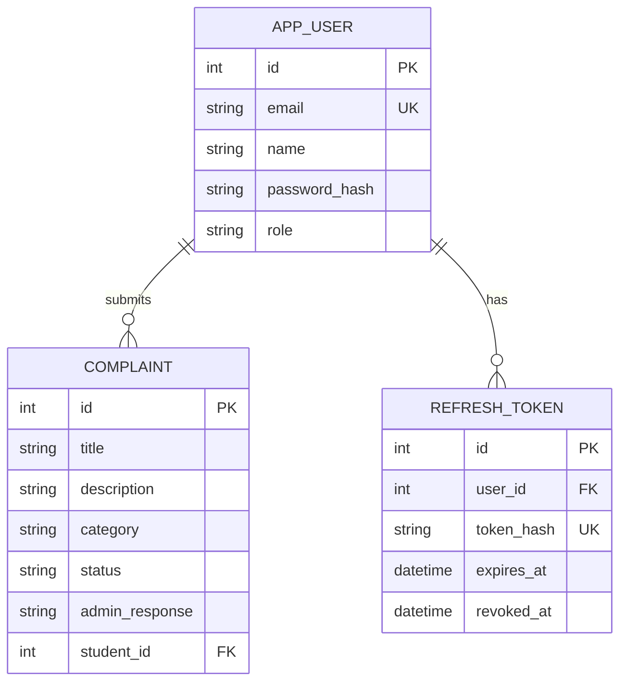

**Who can see a complaint:**
- A student: only complaints where `student_id` is their own id.
- An admin: every complaint.

### 5.3 Schemas

| Schema | Used for | Fields | Release |
|---|---|---|---|
| `ComplaintCreate` | `POST` complaint body | `title`, `description`, `category` | MVP |
| `ComplaintUpdate` | `PATCH` complaint body | all optional: `title`, `description`, `category` | MVP |
| `StatusUpdate` | `PATCH` status body | `status`, `admin_response?` | MVP |
| `ComplaintRead` | Complaint responses | all complaint columns (Beta adds `student_id`) | MVP |
| `SignupRequest` | Sign up | `email`, `name`, `password` | Beta |
| `LoginRequest` | Log in | `email`, `password` | Beta |
| `TokenResponse` | Login / refresh | `access_token`, `token_type: "bearer"`, `expires_in` | Beta |
| `UserRead` | User responses | `id`, `email`, `name`, `role`, `created_at` (never `password_hash`) | Beta |
| `ProfileUpdate` | Change own name | `name` | Beta |
| `PasswordChange` | Change own password | `current_password`, `new_password` | Beta |
| `RoleUpdate` | Change role | `role` | Beta |
| `ProfileDashboard` | Profile dashboard | `user: UserRead`, `complaints {total, pending, in_progress, resolved, rejected}` | Beta |
| `AdminStats` | Admin dashboard | `users {total, admins, new_last_7_days}`, `complaints {total, by_status, by_category, created_last_7_days}` | Beta |

MVP sketch:

```python
class Category(str, Enum):
    academic = "academic"; hostel = "hostel"; library = "library"; cafeteria = "cafeteria"
    transport = "transport"; it_network = "it_network"; other = "other"

class Status(str, Enum):
    pending = "pending"; in_progress = "in_progress"; resolved = "resolved"; rejected = "rejected"

class ComplaintBase(SQLModel):
    title: str = Field(min_length=5, max_length=100)
    description: str = Field(min_length=10, max_length=2000)
    category: Category

class Complaint(ComplaintBase, table=True):
    id: int | None = Field(default=None, primary_key=True)
    status: Status = Status.pending
    admin_response: str | None = Field(default=None, max_length=1000)
    created_at: datetime = Field(default_factory=lambda: datetime.now(timezone.utc))
    updated_at: datetime = Field(default_factory=lambda: datetime.now(timezone.utc))

class ComplaintCreate(ComplaintBase): ...

class ComplaintUpdate(SQLModel):
    title: str | None = Field(default=None, min_length=5, max_length=100)
    description: str | None = Field(default=None, min_length=10, max_length=2000)
    category: Category | None = None

class StatusUpdate(SQLModel):
    status: Status
    admin_response: str | None = Field(default=None, max_length=1000)
```

`title` and `description` are trimmed before validation so spaces-only values are rejected.

Allowed status changes (checked in `service.py`):

```python
ALLOWED = {
    Status.pending: {Status.in_progress, Status.rejected},
    Status.in_progress: {Status.resolved, Status.rejected},
    Status.resolved: set(),
    Status.rejected: set(),
}
```

## 6. REST API design

Base path: `/api/v1`. All bodies are JSON.

### 6.1 Endpoints — MVP

In the MVP no login is needed. In the Beta the same complaint endpoints require a token and a scope (see section 6.2).

| Method | Path | Body | Success | Errors | FR |
|---|---|---|---|---|---|
| `POST` | `/api/v1/complaints` | `ComplaintCreate` | `201` `ComplaintRead` | `422` | FR-01, FR-09, FR-10 |
| `GET` | `/api/v1/complaints?status=&category=&offset=0&limit=20` | — | `200` `ComplaintRead[]` | `422` | FR-02, FR-03, FR-04 |
| `GET` | `/api/v1/complaints/{id}` | — | `200` `ComplaintRead` | `404` | FR-05, FR-11 |
| `PATCH` | `/api/v1/complaints/{id}` | `ComplaintUpdate` | `200` `ComplaintRead` | `404`, `409` (not pending), `422` | FR-06 |
| `DELETE` | `/api/v1/complaints/{id}` | — | `204` | `404`, `409` (not pending) | FR-07 |
| `PATCH` | `/api/v1/complaints/{id}/status` | `StatusUpdate` | `200` `ComplaintRead` | `404`, `409` (invalid change), `422` | FR-08 |
| `GET` | `/api/health` | — | `200` `{"status":"ok"}` | — | FR-12 |

### 6.2 Endpoints — Beta

"Who" uses the roles from the [SRS permission matrix (section 3.9)](02-srs.md#39-permission-matrix--beta). Every endpoint except auth, health and docs needs `Authorization: Bearer <access_token>` (`401` without it) and the listed **scope** (`403` without it).

**Auth**

| Method | Path | Who | Body | Success | Errors | FR |
|---|---|---|---|---|---|---|
| `POST` | `/api/v1/auth/signup` | Guest | `SignupRequest` | `201` `UserRead` | `409`, `422` | FR-14 |
| `POST` | `/api/v1/auth/login` | Guest | `LoginRequest` | `200` `TokenResponse` + cookie | `401` | FR-15 |
| `POST` | `/api/v1/auth/refresh` | Refresh cookie | — | `200` `TokenResponse` + new cookie | `401` | FR-16 |
| `POST` | `/api/v1/auth/logout` | Refresh cookie | — | `204`, cookie cleared | — | FR-17 |

**Profile and dashboard**

| Method | Path | Who | Scope | Body | Success | Errors | FR |
|---|---|---|---|---|---|---|---|
| `GET` | `/api/v1/users/me` | Student, Admin | `profile:manage` | — | `200` `UserRead` | `401` | FR-18 |
| `PATCH` | `/api/v1/users/me` | Student, Admin | `profile:manage` | `ProfileUpdate` | `200` `UserRead` | `422` | FR-19 |
| `POST` | `/api/v1/users/me/password` | Student, Admin | `profile:manage` | `PasswordChange` | `204` (all sessions logged out) | `400` (wrong current password), `422` | FR-20 |
| `GET` | `/api/v1/users/me/dashboard` | Student, Admin | `profile:manage` | — | `200` `ProfileDashboard` | `401` | FR-30 |

**Complaints** — same six endpoints as the MVP, now protected:

| Method | Path | Who | Scope | Beta behaviour | FR |
|---|---|---|---|---|---|
| `POST` | `/api/v1/complaints` | Student | `complaint:create` | Complaint is linked to the caller; admin gets `403` | FR-22 |
| `GET` | `/api/v1/complaints` | Student, Admin | `complaint:read:own` or `complaint:read:all` | Student: own only. Admin: all | FR-22, FR-24 |
| `GET` | `/api/v1/complaints/{id}` | Student, Admin | `complaint:read:own` or `complaint:read:all` | Student: own only, others `404`. Admin: any | FR-23, FR-24 |
| `PATCH` | `/api/v1/complaints/{id}` | Student (own) | `complaint:update:own` | Only while `pending` (`409` otherwise); others' complaint `404`; admin `403` | FR-06, FR-23 |
| `DELETE` | `/api/v1/complaints/{id}` | Student (own), Admin | `complaint:delete:own` or `complaint:delete:any` | Student: own and `pending` only (`409` otherwise). Admin: any | FR-07, FR-26 |
| `PATCH` | `/api/v1/complaints/{id}/status` | Admin | `complaint:status` | Student gets `403` | FR-08, FR-25, FR-32 |

**Admin**

| Method | Path | Who | Scope | Body | Success | Errors | FR |
|---|---|---|---|---|---|---|---|
| `GET` | `/api/v1/admin/users?offset&limit` | Admin | `user:read` | — | `200` `UserRead[]` | `403` | FR-27 |
| `PATCH` | `/api/v1/admin/users/{user_id}/role` | Admin | `user:role` | `RoleUpdate` | `200` `UserRead` | `400` (own role), `403`, `404` | FR-28 |
| `GET` | `/api/v1/admin/stats` | Admin | `stats:read` | — | `200` `AdminStats` | `403` | FR-31 |

### 6.3 Examples

Submit:

```http
POST /api/v1/complaints
Content-Type: application/json

{ "title": "Broken fan in room 204", "description": "The ceiling fan has not worked for a week.", "category": "hostel" }
```

```http
201 Created

{
  "id": 1,
  "title": "Broken fan in room 204",
  "description": "The ceiling fan has not worked for a week.",
  "category": "hostel",
  "status": "pending",
  "admin_response": null,
  "created_at": "2026-10-13T10:00:00Z",
  "updated_at": "2026-10-13T10:00:00Z"
}
```

Resolve (admin):

```http
PATCH /api/v1/complaints/1/status
Content-Type: application/json

{ "status": "in_progress" }
```

Log in (Beta):

```http
POST /api/v1/auth/login
Content-Type: application/json

{ "email": "a@x.com", "password": "correct horse 42" }
```

```http
200 OK
Set-Cookie: refresh_token=...; HttpOnly; Secure; SameSite=Strict; Path=/api/v1/auth; Max-Age=604800

{ "access_token": "eyJhbGciOi...", "token_type": "bearer", "expires_in": 900 }
```

### 6.4 Error format

Use FastAPI's default format so there is no custom code to maintain:

```json
{ "detail": "Complaint not found" }
```

Validation errors (`422`) use FastAPI's built-in list format, which names the failing field:

```json
{ "detail": [ { "loc": ["body", "title"], "msg": "String should have at least 5 characters", "type": "string_too_short" } ] }
```

A catch-all exception handler returns `500` with `{"detail": "Internal server error"}` and logs the real error (NFR-06).

### 6.5 Design rules
- Plural nouns for resources (`/complaints`, `/users`), no verbs in paths (except the `auth` actions and the `/status` sub-resource).
- `PATCH` for partial update; only fields sent are changed (`model_dump(exclude_unset=True)`).
- Lists are ordered by `created_at` descending and take `offset` / `limit`.
- `404` (not `403`) when the caller is not allowed to know a resource exists; `403` when they can see it but not do the action.
- `409` when the request is valid but not allowed in the complaint's current state.
- `/api/v1` prefix so a future `v2` of the API can live next to it.

## 7. Database access

- `database.py` creates one engine from `settings.database_url` (the `DATABASE_URL` env var, defaulting to `backend/ccms.db` locally).
- `get_session()` is a FastAPI dependency that yields a `Session` per request.
- MVP: tables are created on startup with `SQLModel.metadata.create_all(engine)`.
- Beta: `create_all` is removed and the schema is managed by Alembic (section 12).
- On Vercel, connect through Supabase's **transaction pooler** (port `6543`), because each serverless function opens its own connections.
- The transaction pooler does not support prepared statements, so the engine is created with `poolclass=NullPool` and `connect_args={"prepare_threshold": None}` for psycopg.
- URL format: `postgresql+psycopg://postgres.<project-ref>:<password>@aws-0-<region>.pooler.supabase.com:6543/postgres`.
- Only the Postgres database of Supabase is used. Supabase Auth, Storage and the auto-generated REST API are not used; login is our own (section 10) and all access goes through our FastAPI backend.
- Row Level Security (RLS) is not used because the browser never talks to Supabase directly; permissions are enforced in FastAPI. Keep the Supabase `anon` and `service_role` keys out of any frontend.

## 8. Configuration

| Variable | Local | Production (Vercel) | Release |
|---|---|---|---|
| `DATABASE_URL` | not set (SQLite default) | Supabase transaction pooler URL (port `6543`) | MVP (optional), Beta |
| `JWT_SECRET` | any long random string in `.env` | Random 32+ byte secret (`python -c "import secrets; print(secrets.token_urlsafe(48))"`) | Beta |
| `ACCESS_TOKEN_MINUTES` | `15` | `15` | Beta |
| `REFRESH_TOKEN_DAYS` | `7` | `7` | Beta |
| `MIGRATION_DATABASE_URL` | not needed | Not on Vercel. Used only on a developer machine to run Alembic against Supabase (session pooler, port `5432`) | Beta |

No secrets are committed. `.env` stays in `.gitignore`; commit only a `.env.example` with empty values.

Supabase setup (one time, Beta):
1. Create a project at supabase.com and save the database password.
2. **Connect** → **Transaction pooler** → copy the URI, and change the scheme to `postgresql+psycopg://`.
3. In Vercel → Project → **Settings** → **Environment Variables**, add it as `DATABASE_URL`.
4. Add `psycopg[binary]` to `backend/requirements.txt`.

Free-tier Supabase projects pause after a week with no activity; open the dashboard and restore the project before the demo if needed.

## 9. Deployment — Beta

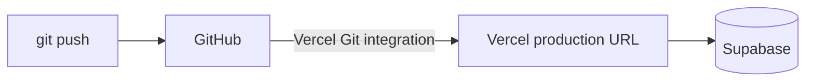

- The MVP is not deployed; it runs locally (`uvicorn`), and the demo uses `/api/docs`.
- For the Beta, connect the GitHub repo to Vercel with the Vercel GitHub integration; a push to `main` deploys to production.
- Environment variables from section 8 are set in the Vercel project settings.
- Before merging a change that includes a new migration, run `alembic upgrade head` against Supabase (section 12), then merge so Vercel deploys the matching code.

## 10. Auth, RBAC and scopes design — Beta

### 10.1 Tokens

| Token | Format | Lifetime | Where it lives |
|---|---|---|---|
| Access token | JWT, HS256, claims `sub` (user id), `role`, `scope`, `iat`, `exp` | 15 min | Frontend memory; sent as `Authorization: Bearer` |
| Refresh token | Random 32 bytes (`secrets.token_urlsafe`) | 7 days | `refresh_token` cookie (`HttpOnly`, `Secure`, `SameSite=Strict`, `Path=/api/v1/auth`); DB keeps only its SHA-256 hash |

- **Refresh rotation:** each refresh revokes the old token and issues a new one. If a revoked token is used again, all of that user's refresh tokens are revoked (it was probably stolen).
- **Logout:** revokes the current refresh token and clears the cookie. The access token simply expires within 15 minutes.
- The `role` and `scope` claims are used for convenience; permission checks also use the role loaded from the database, so a role change applies on the next request.

### 10.2 Passwords

- Hash with `pwdlib` (Argon2). Verify on login; never log or return the hash.
- Unknown email and wrong password both return `401 "Invalid email or password"`, so emails cannot be discovered.
- Password rules: 8–128 characters, at least one letter and one digit.

### 10.3 Security scopes and permission dependencies

Each role is mapped to a fixed set of scopes. At login the scopes of the user's role are written into the access token (`scope` claim, space-separated).

| Scope | Student | Admin | Allows |
|---|---|---|---|
| `complaint:create` | Yes | No | Submit a complaint |
| `complaint:read:own` | Yes | No | List and view own complaints |
| `complaint:read:all` | No | Yes | List and view every complaint |
| `complaint:update:own` | Yes | No | Edit own complaint while `pending` |
| `complaint:delete:own` | Yes | No | Delete own complaint while `pending` |
| `complaint:delete:any` | No | Yes | Delete any complaint |
| `complaint:status` | No | Yes | Change status and admin response |
| `profile:manage` | Yes | Yes | View/edit own profile, change password, own dashboard |
| `user:read` | No | Yes | List users |
| `user:role` | No | Yes | Change a user's role |
| `stats:read` | No | Yes | Admin dashboard stats |

Permissions are FastAPI dependencies, so each route declares what it needs:

```python
bearer = HTTPBearer()

ROLE_SCOPES = {
    "student": {"complaint:create", "complaint:read:own", "complaint:update:own",
                "complaint:delete:own", "profile:manage"},
    "admin": {"complaint:read:all", "complaint:delete:any", "complaint:status",
              "profile:manage", "user:read", "user:role", "stats:read"},
}

def get_current_user(creds=Depends(bearer), session: Session = Depends(get_session)) -> AppUser:
    payload = decode_access_token(creds.credentials)   # 401 if invalid or expired
    user = session.get(AppUser, int(payload["sub"]))
    if user is None:
        raise HTTPException(401, "Invalid token")
    user.token_scopes = set(payload.get("scope", "").split())
    return user

def require_scope(scope: str):
    def checker(user: AppUser = Depends(get_current_user)) -> AppUser:
        # the scope must be in the token AND still allowed for the user's current role
        if scope not in user.token_scopes or scope not in ROLE_SCOPES[user.role]:
            raise HTTPException(403, "Not allowed")
        return user
    return checker
```

| Route | Dependency |
|---|---|
| `POST /complaints` | `require_scope("complaint:create")` |
| `PATCH /complaints/{id}/status` | `require_scope("complaint:status")` |
| `PATCH /complaints/{id}` | `require_scope("complaint:update:own")` |
| `/users/me/*` | `require_scope("profile:manage")` |
| `/admin/users`, `/admin/users/{id}/role`, `/admin/stats` | `require_scope("user:read")`, `("user:role")`, `("stats:read")` |

Rules that depend on the data are checked inside the service:
- `GET /complaints`: if the user has `complaint:read:all` return all; else if `complaint:read:own` filter by `student_id == user.id`; else `403`. `GET /complaints/{id}` follows the same rule; a student's request for someone else's complaint returns `404`.
- `DELETE /complaints/{id}`: with `complaint:delete:any` delete in any status; with `complaint:delete:own` allow only when `student_id == user.id` and status is `pending` (`409` if not pending, `404` if not theirs).
- Change role: `user_id == caller` → `400`.
- Change password: verify `current_password` (`400` if wrong), hash `new_password`, revoke all the user's refresh tokens; the client then logs in again.

### 10.4 Dashboards

Profile dashboard (`GET /users/me/dashboard`): one `GROUP BY status` query on the caller's complaints (`student_id == me`), filled into all four statuses (missing ones are `0`), plus the `UserRead` of the caller. For an admin, the `complaints` counts are of complaints they submitted themselves (normally 0); the admin overview is the admin stats endpoint.

Admin stats (`GET /admin/stats`): plain `COUNT` queries, no extra tables:

```python
week_ago = datetime.now(timezone.utc) - timedelta(days=7)
stats = AdminStats(
    users={
        "total": count(AppUser),
        "admins": count(AppUser, AppUser.role == "admin"),
        "new_last_7_days": count(AppUser, AppUser.created_at >= week_ago),
    },
    complaints={
        "total": count(Complaint),
        "by_status": group_count(Complaint.status),        # {"pending": 12, "in_progress": 3, ...}
        "by_category": group_count(Complaint.category),    # {"hostel": 9, "library": 4, ...}
        "created_last_7_days": count(Complaint, Complaint.created_at >= week_ago),
    },
)
```

`count(model, *filters)` is a small helper around `select(func.count()).select_from(model).where(*filters)`; `group_count(column)` wraps `select(column, func.count()).group_by(column)`.

## 11. Security — Beta

| Area | Design |
|---|---|
| Passwords | Argon2 via `pwdlib`, minimum 8 characters |
| Tokens | Section 10.1; `JWT_SECRET` only in env vars |
| Scopes / RBAC | Section 10.3; every protected route uses `require_scope`; checked on the server for every request |
| Cookies | `HttpOnly`, `Secure`, `SameSite=Strict`, path-limited |
| CORS | Not enabled: frontend and API share the same origin; locally Vite proxies `/api` |
| Security headers | Added for all routes in `vercel.json` (below) |
| Injection | SQLModel/SQLAlchemy parameterised queries only |
| Errors | Catch-all handler returns a generic `500`; details only in logs |
| Data exposure | Response schemas (`UserRead`, `ComplaintRead`) list fields explicitly; `password_hash` and token hashes are never in a response schema |

```json
"headers": [
  {
    "source": "/(.*)",
    "headers": [
      { "key": "X-Content-Type-Options", "value": "nosniff" },
      { "key": "X-Frame-Options", "value": "DENY" },
      { "key": "Referrer-Policy", "value": "strict-origin-when-cross-origin" },
      { "key": "Strict-Transport-Security", "value": "max-age=63072000; includeSubDomains" }
    ]
  }
]
```

## 12. Migrations — Beta

- Add Alembic in `backend/alembic/`, with `target_metadata = SQLModel.metadata`.
- Revision `0001_mvp`: the MVP `complaint` table. On a database already created by `create_all`, run `alembic stamp 0001_mvp` once instead of upgrading.
- Revision `0002_beta`: create `app_user` and `refresh_token`; delete existing MVP demo complaints (they have no owner); add `student_id` (not null) and the indexes to `complaint`.
- Run migrations from a developer machine: `MIGRATION_DATABASE_URL=... alembic upgrade head` (Supabase session pooler, port `5432`), then merge the code.
- After `0002_beta`, remove `create_all` from startup.
- Promote the first admin in the Supabase table editor: set `role = 'admin'` on your `app_user` row.

## 13. Risks

| Risk | Mitigation |
|---|---|
| Too much scope for the semester | Stick to the MVP/Beta lists; Could-have items (F-10, F-21) are dropped first |
| Serverless cold starts make the first request slow | Acceptable; measure NFR-01 excluding cold start |
| Too many DB connections from serverless functions | Use Supabase transaction pooler (port `6543`) with `NullPool` |
| Free-tier project pauses when idle | Check the Supabase dashboard before the demo; any API activity keeps it awake |
| Code deployed before its migration ran (or the reverse) | Always run `alembic upgrade head` before merging a migration; keep migrations additive where possible |
| JWT secret leaked | Only in env vars; rotating it logs everyone out (acceptable) |
| Permission bug exposes another student's complaint | All checks go through the dependencies and service rules in section 10.3; review every new route against the [SRS permission matrix](02-srs.md#39-permission-matrix--beta) |
| No automated tests or CI yet | Review each PR manually against the [SRS acceptance criteria](02-srs.md#5-acceptance-criteria); tests and CI are out of scope this semester |

